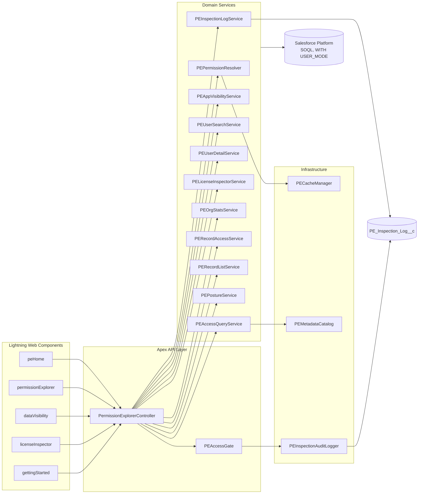

<div align="center">

# Who Sees What

**User Access, Field Security & Record Visibility Explorer for Salesforce**

_Let the people who ask access questions answer them — without handing them Setup._

[](https://developer.salesforce.com/docs/atlas.en-us.api_meta.meta/api_meta/)
[](https://developer.salesforce.com/docs/atlas.en-us.sfdx_dev.meta/sfdx_dev/sfdx_dev_dev2gp.htm)
[](#)
[](#packaging--release)
[](#static-analysis)

[](https://appexchange.salesforce.com/appxListingDetail?listingId=dc0aa216-dbed-49e5-86e0-542869f8dc26)
[](https://youtu.be/-_Jabm_uPrs)

**[▶ View the live listing on the Salesforce AppExchange](https://appexchange.salesforce.com/appxListingDetail?listingId=dc0aa216-dbed-49e5-86e0-542869f8dc26)** · **[▶ Watch the demo](https://youtu.be/-_Jabm_uPrs)**

</div>

---

## Table of Contents

- [Overview](#overview)
- [Why This Exists](#why-this-exists)
- [Features](#features)
- [Demo](#demo)
- [Architecture](#architecture)
- [Installation](#installation)
- [Getting Started](#getting-started)
- [Project Structure](#project-structure)
- [Development](#development)
- [Testing](#testing)
- [Static Analysis](#static-analysis)
- [Packaging & Release](#packaging--release)
- [Security & Privacy](#security--privacy)
- [Known Limitations](#known-limitations)
- [Roadmap](#roadmap)
- [Documentation](#documentation)
- [Contributing](#contributing)
- [Support](#support)
- [License](#license)

---

## Overview

**Who Sees What** is a read-only Salesforce Lightning application that answers a single question
precisely:

> _"What can this user actually see and do — and what granted it?"_

It resolves a user's effective permissions across profiles, permission sets, permission set groups
and **muting permission sets**, then presents the result as an app-scoped walkthrough:
**WHO** (pick a user) → **WHERE** (pick an app, then an object) → **WHAT** (object CRUD and
field-level security, with the grant source attributed).

Since 0.6 it also answers the volume question — *how many records of an object does this user
actually reach, and why* — and shows the audit trail of every inspection in-product.

The product is distributed as a **second-generation managed package (2GP)** under the `twinforce`
namespace.

| | |
| --- | --- |
| **Vendor** | Twinforce Solutions Limited |
| **AppExchange listing** | <https://appexchange.salesforce.com/appxListingDetail?listingId=dc0aa216-dbed-49e5-86e0-542869f8dc26> |
| **Demo video** | <https://youtu.be/-_Jabm_uPrs> |
| **Package ID** | `0HoOW00000000ZV0AY` |
| **Namespace** | `twinforce` |
| **API Version** | 67.0 |
| **Latest build** | `0.6.0-2` · `04tOW00000KhHJtYAN` · Beta |
| **Latest promoted** | `0.3.0-1` · `04tOW00000Gs9l8YAB` |
| **Runtime** | Apex + Lightning Web Components, Platform Cache |
| **External calls** | None. No HTTP callouts, no Named Credentials, no Metadata API callouts. |

---

## Why This Exists

Salesforce ships a native **User Access Summary**, but it lives behind Setup. In practice that means
every access question — from a support lead, a compliance reviewer, a regional manager — routes to
the same one or two system administrators, who then re-derive the same answer by hand.

Who Sees What breaks that bottleneck:

| Native User Access Summary | Who Sees What |
| --- | --- |
| Requires Setup access | Runs as a Lightning app; gated by a custom permission, not by Setup |
| Permission-centric navigation | App-scoped navigation: **App → Tabs → Objects → Fields** |
| No shareable state | Deep links reproduce the exact view for a colleague |
| No inspection record | Append-only audit trail in `PE_Inspection_Log__c` |
| — | **Muting permission sets are subtracted, not ignored** |

That last row matters most. A resolver that simply ORs every permission set together produces
answers that are confidently wrong. Muting subtraction is the difference between a convenience tool
and an auditable one.

---

## Features

### Permission Explorer

- **User search** — keyset-paginated, filterable by profile, role and user type; sortable by name or
  last login; frozen users flagged.
- **Effective permission resolution** — profile (as a permission set) + direct permission sets +
  permission-set-group components − muting permission sets.
- **App-scoped object discovery** — objects reachable from the tabs of a chosen Lightning app, plus
  an explicit _"has access but no tab"_ section so nothing silently disappears.
- **Object detail** — CRUD, View All / Modify All, and full field-level security with each field
  classified as readable, editable, hidden or **not applicable** (formula, auto-number, system audit
  field, master-detail key).
- **Grant attribution** — every permission traces back to the exact profile, permission set,
  permission set group or muting set that produced it.
- **Access trace** — an explain-this-access view for a single permission.
- **Outdated permission set groups** — flagged when `PermissionSetGroup.Status != Updated`, because
  a stale group means the displayed answer is not yet the live answer.

### License Inspector

- User licenses, permission set licenses, package licenses and usage entitlements in one table.
- Drill from any license into the users consuming it.

### Data Visibility

- **Record reach** — how many records of a chosen object a user can get to: records they own, plus
  records shared to them or to a group they belong to.
- **Honest arithmetic** — every figure is labelled **exact** or a **floor**. It is exact when the
  org-wide default is public or the user holds View All; otherwise role-hierarchy access produces no
  countable share rows, so the number is a lower bound and says so.
- **Reason breakdown** — reach grouped by why: ownership, manual share, sharing rule, team.
- **Record list** — one page of actual records with the user's access to each, filterable to
  reachable-only, with a true total that does not depend on which page is on screen.

> The org-wide total is the *running* administrator's view, not the subject's — Apex runs as the
> running user. It is presented as a denominator, never as the subject's answer. See
> [`docs/RECORD-VISIBILITY.md`](docs/RECORD-VISIBILITY.md).

### Home — Org Stats and Posture

- **Org stats** — at-a-glance counts of active users, profiles, permission sets, permission set
  groups, reachable apps and objects with at least one grant.
- **Posture signals** — counts that come with a remedy: groups awaiting recalculation, users holding
  View All Data or Modify All Data, active users who have never signed in, permission sets assigned
  to nobody. A signal that cannot be computed renders as *unavailable*, never as zero.

### Audit

- Every inspection writes an append-only `PE_Inspection_Log__c` row: who inspected whom, when, via
  which action. The packaged permission set grants create and read — never edit or delete.
- **Inspection Log viewer** (0.6) — the trail is now readable in-product, with activity over time,
  busiest inspectors, and filters by inspector or subject. Reading the log is gated but deliberately
  not itself logged.

---

## Demo

**[▶ Watch the walkthrough on YouTube](https://youtu.be/-_Jabm_uPrs)**

A full pass through the product: searching a user, resolving their effective permissions, walking
WHO → WHERE → WHAT, and reading the grant attribution — including the granted-then-muted state.

[](https://youtu.be/-_Jabm_uPrs)

### Screenshots

Getting Started walkthrough images ship as static resources (`hiwStep1`–`hiwStep4`,
`licInspectorGuide`, `whoSeesWhatLogo`).

> **Release requirement.** Any screenshot used in AppExchange listings or security-review documents
> must use fictional data. Real usernames, emails and phone numbers are a review blocker. See
> [`docs/SECURITY-MODEL.md`](docs/SECURITY-MODEL.md).

---

## Architecture



Full C4 context/container/component views, sequence diagrams, the ERD, the state machine for staged
navigation and the release pipeline are in [`docs/diagrams/`](docs/diagrams/).

**Design principles**

1. **Authorisation in Apex, never only in the UI.** Every entry point calls `PEAccessGate`.
2. **Read-only by construction.** The only DML in the product is the append-only audit insert.
3. **No external calls.** Deliberately scoped out to keep AppExchange security review tractable.
4. **Cache is an optimisation, never a source of truth.** `PECacheManager` degrades to an in-request
   map when Platform Cache is unavailable.
5. **Governor limits are budgeted, not hoped for.** `PESoqlChunker` batches `IN :ids` clauses and
   asserts query budget before fan-out.

---

## Installation

### For subscribers

The supported route is the AppExchange listing:

**<https://appexchange.salesforce.com/appxListingDetail?listingId=dc0aa216-dbed-49e5-86e0-542869f8dc26>**

That page carries the current supported version, the listing documentation and the vendor contact.
Use it for any production install.

For beta or pre-release testing, install a specific version directly into a **sandbox or scratch org**
(never production):

```
https://login.salesforce.com/packaging/installPackage.apexp?p0=<04t-version-id>
```

Then:

1. Assign the **PermissionCheckerPermissionSet** permission set to each administrator who may
   inspect other users.
2. Allocate Platform Cache to the **PermissionExplorer** partition (2 MB org, 1 MB session
   recommended; the app works without it, just slower).
3. Open the **Who Sees What** Lightning app.

### For developers

```powershell
git clone https://github.com/DemoProjectDjango/Who-Sees-What.git
cd Who-Sees-What
npm install

sf config set target-org=wsw-dev
sf config set target-dev-hub=WSWDevHub

sf project deploy start --target-org wsw-dev
sf org assign permset --name PermissionCheckerPermissionSet --target-org wsw-dev
sf org open --target-org wsw-dev
```

See [`docs/SALESFORCE-ENVIRONMENTS.md`](docs/SALESFORCE-ENVIRONMENTS.md) for the full org inventory
and the wrong-org deploy hazard.

---

## Getting Started

1. Open the **Who Sees What** app.
2. **Getting Started** tab — guided walkthrough.
3. **Permission Explorer** tab — search a user, pick an app, pick an object, read the field table.
4. **License Inspector** tab — license consumption and the users behind each number.

Copy the browser URL at any point; it encodes the selected user, app and object, so a colleague
lands on exactly the view you were looking at.

---

## Project Structure

```
.
├── config/                       Scratch org definitions
├── docs/                         Architecture, ADRs, diagrams, operational guides
│   ├── adr/                      Architecture Decision Records
│   └── diagrams/                 Mermaid source for all diagrams
├── destructive-p3/               Destructive change manifests
├── force-app/main/default/
│   ├── applications/             Who_Sees_What Lightning app
│   ├── cachePartitions/          PermissionExplorer Platform Cache partition
│   ├── classes/                  Apex (PE* services, controller, DTOs, tests)
│   ├── customPermissions/        Use_Permission_Explorer
│   ├── lwc/                      Lightning Web Components
│   ├── objects/                  PE_Inspection_Log__c
│   ├── permissionsets/           PermissionCheckerPermissionSet
│   ├── staticresources/          Logo and walkthrough imagery
│   └── tabs/                     Permission Explorer, License Inspector, Getting Started
├── scripts/                      Anonymous Apex and SOQL scratchpads
├── code-analyzer.yml             Salesforce Code Analyzer configuration
├── eslint.config.js              LWC lint rules
├── jest.config.js                sfdx-lwc-jest configuration
└── sfdx-project.json             Package directories, namespace, version
```

### Apex class map

| Class | Responsibility |
| --- | --- |
| `PermissionExplorerController` | Sole `@AuraEnabled` surface. Gate, delegate, map to DTOs. |
| `PEAccessGate` | Custom-permission authorisation + audit in one call; target-user guard. |
| `PEPermissionResolver` | Effective permission resolution including muting subtraction. |
| `PEAccessQueryService` | App-scoped object rows, object detail, FLS rows, grant attribution. |
| `PEAppVisibilityService` | Visible Lightning apps for a user. |
| `PEUserSearchService` | Keyset-paginated, filtered user search. |
| `PEUserDetailService` | Login history, assigned permission sets and groups. |
| `PELicenseInspectorService` | License inventory and per-license user drill-down. |
| `PEOrgStatsService` | Org-level counts. |
| `PEMetadataCatalog` | Describe/tab metadata with request-scoped memoisation. |
| `PEFlsClassifier` | Classifies fields that FLS cannot meaningfully apply to. |
| `PECacheManager` | Platform Cache wrapper with version token and safe fallback. |
| `PEKeysetCursor` | Opaque, validated pagination cursor. |
| `PESoqlChunker` | `IN :ids` batching and query-budget assertion. |
| `PEInspectionAuditLogger` | Buffered append-only audit writes. |
| `PEConstants`, `PEDto`, `PELicenseRow`, `PELicenseUserRow` | Constants and transport types. |
| `PermissionExplorerException` | Typed, user-facing, retryable-aware errors. |

---

## Development

### Prerequisites

- Node.js 18 or later
- Salesforce CLI (`sf`) — latest
- VS Code with the Salesforce Extension Pack
- Access to the `WSWDevHub` Dev Hub

### Commands

```powershell
npm install                  # install dev dependencies
npm run lint                 # ESLint over LWC JavaScript
npm run prettier             # format all supported file types
npm run prettier:verify      # check formatting without writing
npm run test:unit            # Jest unit tests for LWC
npm run test:unit:coverage   # Jest with coverage
npm run scan                 # Code Analyzer: AppExchange + Security rulesets
npm run scan:all             # Code Analyzer: Recommended ruleset, detail view
```

A Husky `pre-commit` hook runs `lint-staged`: Prettier on changed files, ESLint on changed LWC
JavaScript, and related Jest tests.

### Conventions

- **Complete file replacements over partial diffs.** LWC bundles must be delivered whole — all four
  files including `.js-meta.xml` — or deployment fails with _"named in package.xml, but was not
  found"_.
- **UTF-8 without BOM.** On Windows, `[System.IO.File]::WriteAllText` with a no-BOM encoding is the
  reliable write path.
- **Bump `CACHE_PREFIX`** in `PEPermissionResolver` whenever the shape of a cached object changes.

See [`CONTRIBUTING.md`](CONTRIBUTING.md) and [`docs/DEVELOPER-GUIDE.md`](docs/DEVELOPER-GUIDE.md).

---

## Testing

| Layer | Tool | Command |
| --- | --- | --- |
| Apex | Salesforce test framework | `sf apex run test --target-org wsw-dev --code-coverage --result-format human` |
| LWC | Jest (`sfdx-lwc-jest`) | `npm run test:unit` |

**11 Apex test classes, 135 test methods** in source. Coverage was last recorded at **88%**
against `0.3.0-1`; re-measure with `--code-coverage` at every version create rather than quoting
that figure.

Apex test classes: `PermissionExplorerTest`, `PermissionExplorerControllerTest`,
`PermissionExplorerFlowTest`, `PEPermissionResolverTest`, `PEMutingMatrixTest`,
`PEUserSearchServiceTest`, `PEUserDetailServiceTest`, `PERecordAccessServiceTest`,
`PERecordListServiceTest`, `PEPostureServiceTest`, `PEInspectionLogServiceTest`.

The **muting correctness matrix** — ten scenarios, the product's most likely silent failure — now
runs as `PEMutingMatrixTest` against synthetic Ids, so it executes in any org with no fixtures.
See [`docs/TESTING.md`](docs/TESTING.md) §3.

---

## Static Analysis

```powershell
npm run scan
```

Uses `code-analyzer.yml`: PMD over Apex only, ESLint engine disabled (LWC JavaScript is linted by the
project's own ESLint configuration instead), SFGE thread timeout raised to 300 s.

Do **not** run `--rule-selector all`; it inflates findings with rules that do not apply to a managed
package and obscures real issues.

Latest recorded results:

| Scan | Result |
| --- | --- |
| Code Analyzer — AppExchange ruleset | 0 violations |
| Code Analyzer — `Recommended:Security` | 0 violations |
| Code Analyzer — full PMD ruleset | 1 violation: `AvoidHardcodingId` (severity 3) in `PEInspectionLogServiceTest`. Test-only, outside both review rulesets. |
| Checkmarx `a0OKX000001JPnJ2AW` (taken at `0.3.0-1`) | 0 security, 0 quality. Re-run before resubmission. |

---

## Packaging & Release

```powershell
sf package version create --package "Who Sees What" --installation-key-bypass --wait 60 --code-coverage --target-dev-hub WSWDevHub
sf package version list --packages "Who Sees What" --target-dev-hub WSWDevHub
sf package version promote --package "Who Sees What@0.6.0-2" --target-dev-hub WSWDevHub
```

`sfdx-project.json` pins `ancestorVersion: HIGHEST`, which enforces an upgradable lineage — a
package version cannot be created if it would break installed subscribers.

Full procedure, ancestry rules and pre-release checklist: [`docs/RELEASE-PROCESS.md`](docs/RELEASE-PROCESS.md).
Version history: [`CHANGELOG.md`](CHANGELOG.md).

---

## Security & Privacy

- **Authorisation.** Every Apex entry point calls `PEAccessGate.assertAuthorised()` or
  `assertAuthorisedAndLog()`. The gate checks the packaged `Use_Permission_Explorer` custom
  permission via `FeatureManagement.checkPermission` and is deliberately uncached, so it cannot
  outlive the context that produced it.
- **Sharing and CRUD/FLS.** All classes are `with sharing`. User-facing queries use
  `WITH USER_MODE`.
- **Data egress.** None. No callouts, no Named Credentials, no Metadata API callouts.
- **Audit.** `PE_Inspection_Log__c` is append-only — create and read granted, edit and delete
  withheld — so an inspection cannot occur without leaving a record.
- **Secrets.** Never commit credentials, tokens, SFDX auth URLs or connected-app secrets. See
  §9 of [`docs/SALESFORCE-ENVIRONMENTS.md`](docs/SALESFORCE-ENVIRONMENTS.md).

Report a vulnerability privately — see [`SECURITY.md`](SECURITY.md). Do not open a public issue.

Full threat model: [`docs/SECURITY-MODEL.md`](docs/SECURITY-MODEL.md).

---

## Known Limitations

These are platform constraints, not defects. Each was verified independently before being accepted.

| Limitation | Cause |
| --- | --- |
| Per-user **record type** visibility is not shown | `Profile.recordTypeVisibilities` and `PermissionSet.recordTypeVisibilities` are Metadata API only; not exposed to SOQL or Apex Schema. |
| Per-user **page layout** assignment is not shown | Layout assignment is Profile × RecordType only; no permission set participates, and `Schema.Layout` does not exist in Apex. |
| Per-permission-set **app visibility** is not shown | No queryable sObject exists for it. The app column resolves from `AppMenuItem` and is labelled an estimate. |
| **Standard object tab** visibility is not shown | `PermissionSetTabSetting` stores custom tabs only. |

| Per-user **record reach** is a floor, not a total, under a private org-wide default | Role-hierarchy access produces no share rows to count, and `UserRecordAccess` for another user needs View All Data. Labelled as a floor wherever it is shown. |

The record type catalogue currently rendered from the queryable `RecordType` object is org-wide, not
per-user, and is labelled as such.

---

## Roadmap

| Version | Scope | State |
| --- | --- | --- |
| **0.4** | UI redesign, staged WHO/WHERE/WHAT navigation | Shipped |
| **0.5** | Access trace, License Inspector, org stats bar | Shipped |
| **0.6** (current) | Data Visibility (record reach, reason breakdown, record list) · Inspection Log viewer · Home with posture signals · muting correctness matrix executed | Beta `0.6.0-2` |
| **0.7** | Record type and page layout visibility via the Apex Metadata API · Inspection Log export | Planned |
| **0.8+** | Compare Two Users · What-If Simulator · Record Access Diagnosis | Planned |

Feature ordering is driven by fit with the delegation USP. `Record Access Diagnosis` is deliberately
late: querying `UserRecordAccess` for another user requires **View All Data**, which conflicts with
the product's core promise.

Full detail, sequencing rationale and the explicitly declined features are in
[`docs/ROADMAP.md`](docs/ROADMAP.md).

---

## Documentation

| Document | Contents |
| --- | --- |
| [`docs/README.md`](docs/README.md) | Documentation index |
| [`docs/ARCHITECTURE.md`](docs/ARCHITECTURE.md) | Layers, boundaries, quality attributes |
| [`docs/PERMISSION-RESOLUTION.md`](docs/PERMISSION-RESOLUTION.md) | The resolution algorithm, including muting |
| [`docs/RECORD-VISIBILITY.md`](docs/RECORD-VISIBILITY.md) | How record reach is computed, and when it is exact |
| [`docs/AUDIT-TRAIL.md`](docs/AUDIT-TRAIL.md) | What is logged, what is not, and why |
| [`docs/DATA-MODEL.md`](docs/DATA-MODEL.md) | Custom object, DTOs, platform objects consumed |
| [`docs/SECURITY-MODEL.md`](docs/SECURITY-MODEL.md) | Threat model and review posture |
| [`docs/API-REFERENCE.md`](docs/API-REFERENCE.md) | `@AuraEnabled` surface |
| [`docs/DEVELOPER-GUIDE.md`](docs/DEVELOPER-GUIDE.md) | Environment setup and daily workflow |
| [`docs/TESTING.md`](docs/TESTING.md) | Test strategy and the muting correctness matrix |
| [`docs/RELEASE-PROCESS.md`](docs/RELEASE-PROCESS.md) | 2GP packaging and promotion |
| [`docs/TROUBLESHOOTING.md`](docs/TROUBLESHOOTING.md) | Platform gotchas already paid for once |
| [`docs/GLOSSARY.md`](docs/GLOSSARY.md) | Domain vocabulary |
| [`docs/ROADMAP.md`](docs/ROADMAP.md) | Sequencing and declined features |
| [`docs/UPGRADE-NOTES.md`](docs/UPGRADE-NOTES.md) | What a subscriber must do on upgrade |
| [`docs/DEMO-ORG-SEED.md`](docs/DEMO-ORG-SEED.md) | Seeding the reviewer and demo org with fictional data |
| [`docs/LISTING-COPY.md`](docs/LISTING-COPY.md) | AppExchange listing copy of record and claim control |
| [`docs/SALESFORCE-ENVIRONMENTS.md`](docs/SALESFORCE-ENVIRONMENTS.md) | Org and repository inventory |
| [`docs/adr/`](docs/adr/) | Architecture Decision Records |
| [`docs/diagrams/`](docs/diagrams/) | All diagrams (Mermaid source) |

---

## Contributing

See [`CONTRIBUTING.md`](CONTRIBUTING.md) for branch naming, commit conventions, the review checklist
and the definition of done.

---

## Support

- **AppExchange listing** — <https://appexchange.salesforce.com/appxListingDetail?listingId=dc0aa216-dbed-49e5-86e0-542869f8dc26>
- **Demo video** — <https://youtu.be/-_Jabm_uPrs>
- **Issues** — <https://github.com/DemoProjectDjango/Who-Sees-What/issues>
- **Vendor** — Twinforce Solutions Limited

---

## License

Proprietary. © Twinforce Solutions Limited. All rights reserved.

This source is not licensed for redistribution. The compiled product is distributed exclusively as a
managed package through the [Salesforce AppExchange](https://appexchange.salesforce.com/appxListingDetail?listingId=dc0aa216-dbed-49e5-86e0-542869f8dc26).
