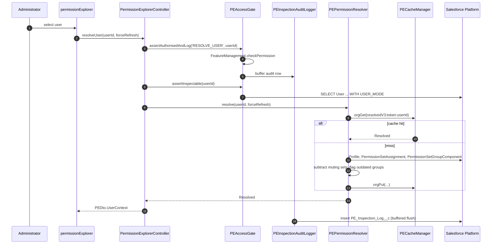

# Architecture

**Status:** current as of version 0.5
**Audience:** engineers joining the codebase, AppExchange security reviewers, technical evaluators

---

## 1. Purpose and Context

Who Sees What answers _"what can this user see and do, and what granted it?"_ from inside a Lightning
app rather than from Setup. It reads Salesforce permission metadata, resolves it into an effective
access picture, and presents it app-first.

The product is read-only. The only write in the entire codebase is an append-only audit insert.

---

## 2. Quality Attributes (in priority order)

| # | Attribute | How it is achieved | How it is verified |
| --- | --- | --- | --- |
| 1 | **Correctness** | Muting permission sets are subtracted, not ignored. Outdated permission set groups are flagged rather than silently trusted. | `PEPermissionResolverTest` + the correctness matrix in [TESTING.md](TESTING.md) |
| 2 | **Security review defensibility** | Custom-permission gate in Apex, `with sharing` everywhere, `WITH USER_MODE` on user-facing queries, zero callouts, append-only audit | Checkmarx + Code Analyzer AppExchange/Security rulesets |
| 3 | **Governor-limit safety** | `PESoqlChunker` batches `IN :ids`; query budget asserted before fan-out; Platform Cache for resolved permission graphs | `PermissionExplorerFlowTest` |
| 4 | **Responsiveness** | Keyset pagination (no `OFFSET`), org- and session-scoped caching, request-scoped describe memoisation | Manual profiling in `wsw-dev` |
| 5 | **Comprehensibility for non-technical users** | Plain-language labels, staged navigation, explicit "not applicable" classification | UX copy audit |

---

## 3. Layering

```
┌──────────────────────────────────────────────────────────────┐
│  Presentation — Lightning Web Components                     │
│  permissionExplorer · licenseInspector · gettingStarted      │
│  + ~20 presentational child components, peUtils helpers      │
├──────────────────────────────────────────────────────────────┤
│  API — PermissionExplorerController                          │
│  The only @AuraEnabled surface. Gate → delegate → map → DTO. │
├──────────────────────────────────────────────────────────────┤
│  Authorisation — PEAccessGate + PEInspectionAuditLogger      │
│  Custom permission check and audit write, together.          │
├──────────────────────────────────────────────────────────────┤
│  Domain services                                             │
│  PEPermissionResolver · PEAccessQueryService                 │
│  PEAppVisibilityService · PEUserSearchService                │
│  PEUserDetailService · PELicenseInspectorService             │
│  PEOrgStatsService · PEFlsClassifier                         │
├──────────────────────────────────────────────────────────────┤
│  Infrastructure                                              │
│  PECacheManager · PEMetadataCatalog · PESoqlChunker          │
│  PEKeysetCursor · PEConstants · PEDto                        │
├──────────────────────────────────────────────────────────────┤
│  Salesforce Platform                                         │
│  SOQL over permission metadata · Schema describes            │
│  Platform Cache · PE_Inspection_Log__c                       │
└──────────────────────────────────────────────────────────────┘
```

### Layer rules

- LWCs **never** import an Apex method other than one on `PermissionExplorerController`.
- Domain services **never** talk to each other's internals; they exchange `PEDto` types and
  `PEPermissionResolver.Resolved`.
- Only `PEAccessGate` decides authorisation. No service re-implements the check, and no UI state
  substitutes for it.
- Only `PEInspectionAuditLogger` performs DML.

---

## 4. Key Components

### `PermissionExplorerController`

The single `@AuraEnabled` surface. Each method follows the same shape:

```apex
@AuraEnabled
public static PEDto.Something doThing(Id userId, ...) {
    try {
        PEAccessGate.assertAuthorisedAndLog('ACTION', userId, detail);
        User u = PEAccessGate.assertInspectable(userId);
        // delegate to a service, map to DTO
    } catch (Exception e) {
        throw toAura(e);
    }
}
```

`getFilterOptions` is the only `cacheable=true` method — it returns org-shaped reference data
(profiles, roles, user types), not user-specific access.

`toAura` converts typed `PermissionExplorerException`s into `AuraHandledException`s carrying a
user-facing message and a `retryable` flag, so the UI can distinguish "try again" from "ask an admin".

### `PEPermissionResolver`

The heart of the product. Produces a `Resolved` graph:

| Field | Meaning |
| --- | --- |
| `effectiveParents` | Permission set IDs that contribute grants (profile-as-permission-set, direct assignments, group components) |
| `mutingParents` | Permission set IDs of type `Muting` that subtract |
| `sourcesById` | Attribution metadata per parent — label, kind (`profile` / `permset` / `group` / `muting`), group label |
| `outdatedGroups` | Permission set groups whose `Status != Updated` |
| `directPermSets`, `assignedGroups` | For the "granted by" panel |

Results are cached under `CACHE_PREFIX` (`resolvedV3`). **Bump that prefix whenever the shape of
`Resolved` changes** — a stale cached object of the old shape deserialises into confident nonsense.

See [PERMISSION-RESOLUTION.md](PERMISSION-RESOLUTION.md) for the algorithm.

### `PEAccessQueryService`

Turns a `Resolved` graph plus an app into rows:

1. `PEMetadataCatalog.getAppTabs(app)` → tabs in the app.
2. Map tab names to object API names.
3. Apply `PermissionSetTabSetting` visibility for the effective parents.
4. Apply `ObjectPermissions` for the effective parents, merging CRUD.
5. Append an explicit **"access without a tab"** section, so objects the user can reach but cannot
   navigate to are still surfaced rather than silently dropped.

`getObjectDetail` then builds CRUD grants, field permissions (via `FieldPermissions` seeded against
the describe field map) and the record type catalogue.

### `PEFlsClassifier`

Classifies fields where field-level security is not a meaningful concept — formula fields,
auto-numbers, system audit fields, master-detail keys — and returns a **reason**. Showing "hidden"
for a formula field would be technically true and practically misleading; showing
"not applicable — formula field" is neither.

### `PECacheManager`

Two-tier wrapper over Platform Cache:

- **Org partition** — resolved permission graphs, org stats, license data. Shared across users.
- **Session partition** — per-user working state.
- **Version token** — a single org-scoped token participates in every cache key. `bumpVersionToken()`
  invalidates everything at once, which is what the UI's refresh action does.
- **Fallback** — if the partition is unavailable (not allocated in the subscriber org), reads and
  writes degrade to a request-scoped map. The product works; it is just slower.

Cache availability is resolved lazily and memoised through explicit `*Resolved` booleans rather than
static property getters — a property getter that calls itself is an infinite recursion, which this
codebase has already encountered once.

### `PEKeysetCursor`

Opaque, validated pagination cursor encoding `sortField`, `sortValue` and `lastId`. Sort fields are
whitelisted (`Name`, `LastLoginDate`). A malformed or tampered cursor raises a typed exception rather
than being coerced into a query. Keyset beats `OFFSET` here because user tables in large orgs make
deep offsets expensive and unstable under concurrent edits.

---

## 5. Data Flow



---

## 6. Deliberate Exclusions

| Excluded | Reason |
| --- | --- |
| HTTP callouts, Named Credentials | Every external endpoint is a security-review question. Zero is the cheapest answer. |
| Metadata API callouts | Same. Deferred to 0.6, where the benefit (record types, layouts) justifies the cost. |
| Writes of any kind except the audit log | A read-only tool cannot break a subscriber's org. |
| `UserRecordAccess` queries for other users | Requires **View All Data**, which contradicts the product's delegation promise. |
| Custom REST/SOAP endpoints | No external surface area. |

---

## 7. Platform Constraints Accepted

Verified independently; not defects.

- `Profile.recordTypeVisibilities` and `PermissionSet.recordTypeVisibilities` are Metadata API only.
- Page layout assignment is Profile × RecordType; no permission set participates. `Schema.Layout`
  does not exist in Apex.
- App visibility per permission set has no queryable sObject.
- `PermissionSetTabSetting` holds custom tabs only, never standard object tabs.
- `TabDefinition` has no `IsCustom` field.

---

## 8. Open Architectural Risks

| Risk | Impact | Mitigation |
| --- | --- | --- |
| Muting subtraction not yet fully verified | Undermines the core differentiator and any audit claim | Complete the correctness matrix in [TESTING.md](TESTING.md) before the next release |
| `PE_Inspection_Log__c` is write-only in the UI | A differentiator the user cannot see | Inspection Log viewer scheduled for 0.6 |
| Record type catalogue is org-wide, not per-user | Reads as an answer to a question it does not answer | Labelled as org-wide; replaced in 0.6 via Metadata API |
| Platform Cache unallocated in subscriber orgs | Slower first load per user | Graceful fallback already implemented; documented in install steps |

---

## 9. See Also

- [diagrams/](diagrams/) — C4 context, container and component views, ERD, state machine, pipeline
- [adr/](adr/) — the decisions behind the structure above
