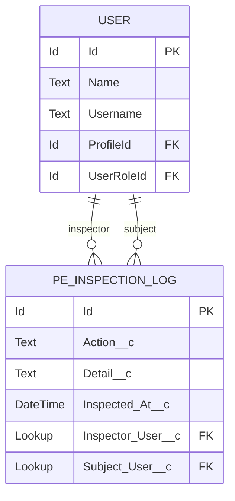

# Data Model

What this product stores, and what it reads.

---

## 1. Storage Footprint

The package creates exactly **one** custom object. Nothing else is persisted.

### `PE_Inspection_Log__c`

Append-only audit of every permission inspection.

| Field | API name | Type | Purpose |
| --- | --- | --- | --- |
| Action | `Action__c` | Text | Which entry point was used (`RESOLVE_USER`, `OBJECT_DETAIL`, …) |
| Detail | `Detail__c` | Text | Contextual detail — app, object, filter |
| Inspected At | `Inspected_At__c` | DateTime | When the inspection occurred |
| Inspector User | `Inspector_User__c` | Lookup(User) | The administrator performing the inspection |
| Subject User | `Subject_User__c` | Lookup(User) | The user whose access was inspected |

**Access posture.** The packaged permission set grants **Create + Read only**. Edit, Delete,
View All and Modify All are all withheld. An inspector cannot rewrite or erase their own trail —
which is the only reason the trail is worth anything.

**Write path.** `PEInspectionAuditLogger` buffers rows in a static list and flushes once, so a
request that touches several services still produces a single DML statement. This is the **only**
DML in the codebase.

**Read path.** `PEInspectionLogService` reads the same object for the in-product viewer. It has no
update or delete path. Its query is built from `Schema.SObjectType` so the names carry the
`twinforce__` prefix for a subscriber — dynamic SOQL does not add it for you.

`Action__c` and `Inspected_At__c` are **required**, so they are universally readable and carry no
`FieldPermissions` entry in the packaged permission set. That is correct, not an omission.

Full treatment of what is written, what deliberately is not, and retention:
[AUDIT-TRAIL.md](AUDIT-TRAIL.md).

---

## 2. Platform Objects Read

All reads. No object below is ever written.

### Identity and org shape

| Object | Used by | For |
| --- | --- | --- |
| `User` | `PEAccessGate`, `PEUserSearchService` | Search, guard, summary (profile, role, manager, department, last login) |
| `Profile` | `PEPermissionResolver`, `PEUserSearchService` | Profile label, filter options |
| `UserRole` | `PEUserSearchService` | Filter options |
| `LoginHistory` | `PEUserDetailService` | Recent login activity |

### Permission graph

| Object | Used by | For |
| --- | --- | --- |
| `PermissionSet` | `PEPermissionResolver` | Profile-as-permission-set, labels, `Type` (muting detection) |
| `PermissionSetAssignment` | `PEPermissionResolver` | Direct and group-derived assignments |
| `PermissionSetGroup` | `PEPermissionResolver` | Group label and `Status` (outdated detection) |
| `PermissionSetGroupComponent` | `PEPermissionResolver` | Group → component set expansion |
| `ObjectPermissions` | `PEAccessQueryService` | CRUD, View All, Modify All per parent |
| `FieldPermissions` | `PEAccessQueryService` | Field read/edit per parent |
| `PermissionSetTabSetting` | `PEAccessQueryService` | Custom tab visibility (custom tabs only) |
| `SetupEntityAccess` | `PEPermissionResolver` | Custom permission assignment |

### Navigation and metadata

| Object / API | Used by | For |
| --- | --- | --- |
| `AppMenuItem` | `PEAppVisibilityService` | Apps visible to the user |
| `TabDefinition` | `PEMetadataCatalog` | Tab inventory (note: has no `IsCustom` field) |
| `RecordType` | `PEAccessQueryService` | Org-wide record type catalogue (**not** per-user) |
| `EntityDefinition` | `PERecordAccessService` | Internal and external org-wide defaults. Authoritative. |
| `<Object>Share` (e.g. `AccountShare`, `Custom__Share`) | `PERecordAccessService`, `PERecordListService` | Countable share rows and their `RowCause`. Role-hierarchy access writes none — which is why a private-OWD figure is a floor. |
| The target object itself | `PERecordListService` | One page of records, plus the owned and total counts |
| `Schema.getGlobalDescribe()` | `PEMetadataCatalog` | Object labels, sharing model |
| `Schema.DescribeFieldResult` | `PEFlsClassifier` | Field type, calculated, auto-number, relationship |

### Licensing

| Object | Used by |
| --- | --- |
| `UserLicense` | `PELicenseInspectorService` |
| `PermissionSetLicense`, `PermissionSetLicenseAssign` | `PELicenseInspectorService` |
| `PackageLicense`, `UserPackageLicense` | `PELicenseInspectorService` |
| `TenantUsageEntitlement` | `PELicenseInspectorService` |

---

## 3. Transport Types (`PEDto`)

Apex → LWC transport. All members are `@AuraEnabled`.

| Type | Carries |
| --- | --- |
| `Source` | Attribution: parent ID, label, kind, group label, outdated flag, linkable |
| `Grant` | Permission name, label, `granted`, `muted`, contributing sources |
| `UserRow` | Search result row: name, username, profile, role, last login, frozen |
| `UserSummary` | Selected-user header: email, department, manager, licence, counts |
| `UserContext` | Summary + resolved graph metadata + outdated group warnings |
| `PagedResult` | `records`, `hasMore`, `nextCursor`, `pageSize`, `capReached` |
| `AppList` / `ObjectRow` | Visible apps; per-object CRUD row with tab visibility |
| `ObjectDetail` | Object grants, `FieldPerm` list, record types, sharing model |
| `FieldPerm` | Field API name, label, readable, editable, not-applicable + reason |
| `PermSetRow` / `PermSetGroupRow` / `PermSetList` | Granted-by panel |
| `LoginHistoryResult` | Login rows + truncation flag |
| `OrgStats` | Active users, profiles, permission sets, groups, reachable apps, objects with a grant |
| `RecordTypeRow` | Record type name and label (org-wide) |
| `ErrorInfo` | `cause`, `message`, `retryable` |

> `List<Object>` is **not** serialisable across `@AuraEnabled`. Every collection must be typed —
> `List<PEDto.Grant>`, never `List<Object>`.

`PELicenseRow` and `PELicenseUserRow` are separate top-level classes because the License Inspector
serialises to JSON strings rather than returning typed DTOs.

### Service-owned transport types

Three subsystems carry their own `@AuraEnabled` inner classes rather than adding to `PEDto`. They
are cohesive with one service and nothing else consumes them.

| Type | Carries | Flags that must not be dropped by the client |
| --- | --- | --- |
| `PERecordAccessService.Reach` | OWD, sharing label, total / owned / shared / reachable counts | **`isExact`** |
| `PERecordListService.RecordPage` | Rows, cursor, reachable and org totals | **`totalIsFloor`**, `sharingBypassed`, `hasNameField`, `searchSupported` |
| `PERecordListService.ReasonBucket` | Share cause, label, count | — |
| `PEPostureService.Posture` | Signals, licence use, active users | A null count is **unavailable**, not zero |
| `PEInspectionLogService.LogPage` | Rows, counts, activity series, top inspectors | `readable`, `notice`; null counts are unavailable |

---

## 4. Cache Keys

| Key shape | Partition | TTL | Holds |
| --- | --- | --- | --- |
| `orgVersionToken` | Org | long | The invalidation token participating in every other key |
| `resolvedV4:<token>:<userId>` | Org | medium | `PEPermissionResolver.Resolved` |
| `orgStats:<token>` | Org | medium | `PEDto.OrgStats` |
| `licenses:<token>` | Org | medium | Serialised license rows |
| `postureV1` | Org | medium | `PEPostureService.Posture` |

`CACHE_PREFIX` for the resolver is **`resolvedV4`** as of 0.6, bumped for the muting-scope change to
`Resolved`. A stale object of the previous shape does not error — it silently loses fields, which
reads as *this user has no muting sets*.

Data Visibility is **not** cached. Record counts move; a cached reach figure would be confidently
wrong within minutes, and the whole subsystem exists to avoid confidently wrong numbers.

Keys are sanitised by `PECacheManager.safeKey` — Platform Cache keys are alphanumeric only, and an
unsanitised object API name or username will throw.

---

## 5. Retention and Growth

`PE_Inspection_Log__c` grows one row per inspection action and is never pruned by the package.
Subscribers who need retention limits should apply their own scheduled deletion; the package
deliberately does not delete data it did not ask permission to delete, and ships no Delete
permission to do it with.

`VIEW_RECORD_LIST` is written once **per page**, not once per session, so Data Visibility is the
fastest-growing contributor. Rough sizing: 20 inspectors × 50 inspections per working day is on the
order of a quarter of a million rows a year. Well within storage limits for most orgs, and worth
raising before it surprises anyone. See [AUDIT-TRAIL.md](AUDIT-TRAIL.md) §7.
