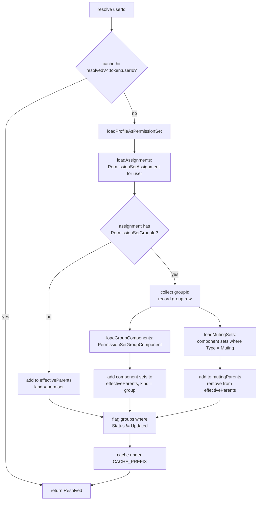

# Permission Resolution

How `PEPermissionResolver` turns a user ID into an effective access picture, and why the naive
version is wrong.

---

## 1. The Naive Version (and why it fails)

Most permission-inspection tools do this:

```
effective = profile ∪ permissionSet₁ ∪ permissionSet₂ ∪ … ∪ groupComponents
```

That is a union of grants. It is wrong in any org that uses **permission set groups with muting
permission sets**, because a muting permission set exists precisely to *remove* a permission that a
component set grants. A union-only resolver reports the permission as granted. The user does not
have it. The tool is confidently wrong — the worst failure mode for an audit tool.

**Muting subtraction is the single most common correctness failure in this category of product.**

---

## 2. The Model

Salesforce resolves permissions through a small number of containers, all of which are ultimately
`PermissionSet` records:

| Container | How it appears | Effect |
| --- | --- | --- |
| Profile | A `PermissionSet` with `IsOwnedByProfile = true` | Grants |
| Permission set (direct assignment) | `PermissionSetAssignment` with no `PermissionSetGroupId` | Grants |
| Permission set group | `PermissionSetAssignment` with a `PermissionSetGroupId` | Container only |
| Group component set | `PermissionSetGroupComponent` → `PermissionSet` | Grants |
| Muting permission set | `PermissionSet.Type = 'Muting'`, attached to a group | **Subtracts** |

Because the profile is itself a permission set, the resolver can treat every source uniformly. This
is why `loadProfileAsPermissionSet` exists: it converts the profile into a parent ID that sits
alongside every other parent, so downstream `ObjectPermissions` and `FieldPermissions` queries need
only one `ParentId IN :ids` clause.

---

## 3. The Algorithm



### Step by step

1. **Profile as permission set.** Query the `PermissionSet` where `ProfileId` matches the user's
   profile. Record it as `kind = 'profile'` with the profile's label.

2. **Direct assignments.** Query `PermissionSetAssignment` for the user. Split on
   `PermissionSetGroupId`:
   - null → a direct permission set. Add to `effectiveParents` as `kind = 'permset'`.
   - non-null → a group assignment. Record the group for step 3.

3. **Group components.** For each assigned group, query `PermissionSetGroupComponent`. Each
   component's `PermissionSetId` joins `effectiveParents` as `kind = 'group'`, carrying the group's
   label so attribution can say _"via the Sales Power group"_ rather than just naming a set the
   admin never assigned directly.

4. **Muting.** Component sets where `PermissionSet.Type = 'Muting'` are moved into `mutingParents`
   and **removed from** `effectiveParents`. They must not contribute grants — they only remove them.

5. **Outdated groups.** Any group with `Status != 'Updated'` is recorded in `outdatedGroups`. A group
   in this state has pending recalculation; the org's live behaviour may not yet match its
   definition. The UI surfaces this rather than hiding it, because an unflagged stale answer is worse
   than a flagged uncertain one.

6. **Cache.** The `Resolved` graph is written to the org partition under
   `resolvedV4:<versionToken>:<userId>`.

---

## 4. Applying a Grant

`PEPermissionResolver.applyGrant` is where subtraction actually bites. For a given permission name
(for example `PermissionsViewAllData`):

```
granted = ∃ parent ∈ effectiveParents where parent[permission] = true
muted   = granted AND ∃ parent ∈ mutingParents where parent[permission] = true
```

The resulting `PEDto.Grant` carries **both flags**:

| `granted` | `muted` | UI meaning |
| --- | --- | --- |
| `true` | `false` | Granted — green |
| `true` | `true` | **Granted then muted** — amber. The user does *not* have it. |
| `false` | `false` | Not granted — red |

Reporting `granted = false` for a muted permission would be the correct effective answer but a poor
diagnostic one. The admin needs to know a grant exists *and* that something is cancelling it —
otherwise they go looking for a grant to add that is already there.

---

## 5. Attribution

`sourcesById` maps every parent ID to a `PEDto.Source`:

| Field | Purpose |
| --- | --- |
| `parentId` | The permission set ID |
| `label` | Human-readable name |
| `kind` | `profile` · `permset` · `group` · `muting` |
| `groupLabel` | Set when `kind = group`; names the group the component came from |
| `isOutdatedGroup` | True when the owning group's status is not `Updated` |
| `linkable` | Whether the UI may deep-link to the record |

Each `Grant` carries the list of sources that produced it, which is what makes the answer
actionable rather than merely true.

---

## 6. Caching Contract

| Property | Value |
| --- | --- |
| Key | `resolvedV4:<versionToken>:<userId>` |
| Partition | Org (shared across administrators) |
| Invalidation | `PECacheManager.bumpVersionToken()` — invalidates the whole product at once |
| Bypass | `resolve(userId, forceRefresh = true)` |
| Fallback | Request-scoped map when Platform Cache is unavailable |

**`CACHE_PREFIX` must be bumped whenever the shape of `Resolved` changes.** A deserialised object of
the previous shape will not error — it will silently lose fields, which reads as "this user has no
muting sets".

---

## 7. What This Does Not Resolve

| Not resolved | Why |
| --- | --- |
| Per-user record type visibility | `recordTypeVisibilities` is Metadata API only |
| Per-user page layout assignment | Profile × RecordType only; no permission set participates |
| Per-permission-set app visibility | No queryable sObject |
| Standard object tab visibility | `PermissionSetTabSetting` holds custom tabs only |
| Record-level (sharing) access, exactly | Would require `UserRecordAccess` for another user, which needs View All Data |

Record-level access is now **approximated** rather than ignored. `PERecordAccessService` and
`PERecordListService` compute how many records a user reaches from org-wide defaults, ownership and
share rows, and label every figure as exact or as a floor. That subsystem is documented separately in
[RECORD-VISIBILITY.md](RECORD-VISIBILITY.md). It does not run through `PEPermissionResolver` and
changes nothing in this document.

---

## 8. Correctness Obligations

**Status as of 0.6: the matrix passes.** `PEMutingMatrixTest` executes all ten scenarios from
[TESTING.md](TESTING.md) §3 against synthetic Ids — no DML, no SOQL, no org fixtures — so it runs in
any org, including a reviewer's.

Before that class existed, scenarios 5, 6 and 8 all reported *no access* for users who genuinely held
the permission, because muting was stored as one flat set with no record of which group each muting
set belonged to. Muting is now scoped to its own group, which is what the platform actually does.

The obligations the matrix enforces:

- A permission granted by a group component and muted by the group's muting set reports
  `granted = true, muted = true`.
- A permission granted by a **direct** assignment and muted by an unrelated group's muting set is
  **not** suppressed. Muting applies within its group's scope, not org-wide.
- A muting set never appears in `effectiveParents`.
- An outdated group's contribution is included *and* flagged, never silently excluded.
