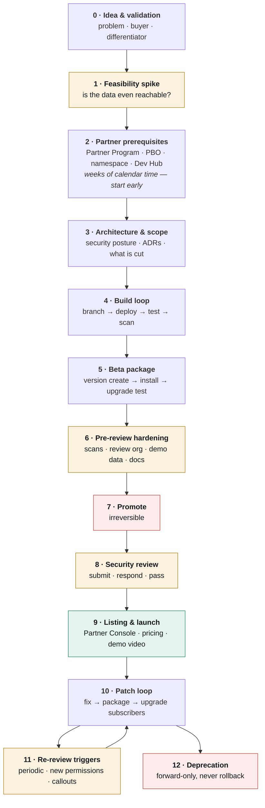

# Pipeline — Building and Shipping a Salesforce AppExchange Product

A product-agnostic lifecycle for any Salesforce ISV managed package: from an idea, through build and
packaging, through security review and listing, and then the ongoing loop of patches, upgrades and
re-reviews.

Nothing here is specific to one product. Fill in the placeholders below once and every command in
this document becomes copy-pasteable.

**Assumptions:** Salesforce DX, second-generation managed packaging (2GP), Salesforce CLI (`sf`),
Node.js tooling, Git. Commands are written for PowerShell on Windows; they work on macOS and Linux
with backticks replaced by backslashes for line continuation.

---

## Placeholders used throughout

| Placeholder | Meaning | Example |
| --- | --- | --- |
| `<PACKAGE_NAME>` | Package name in `sfdx-project.json` | `"My Product"` |
| `<PACKAGE_ID>` | Package ID | `0Ho...` |
| `<VERSION_ID>` | A specific package version | `04t...` |
| `<NAMESPACE>` | Registered managed namespace | `acmeco` |
| `<DEVHUB_ALIAS>` | Dev Hub org alias | `AcmeDevHub` |
| `<DEV_ALIAS>` | Development org alias | `acme-dev` |
| `<TEST_ALIAS>` | Package install-test org alias | `acme-test` |
| `<PERMSET_NAME>` | Packaged permission set | `MyProductAdmin` |
| `<REPO_URL>` | Git repository | `https://github.com/org/repo` |

Record the real values in a `docs/SALESFORCE-ENVIRONMENTS.md` alongside this file, not inline here.

---

## Pipeline at a glance



**Typical first-release timeline.** Phases 0–3 take days to weeks. Phase 2 runs in parallel and takes
weeks on its own. Phase 4 dominates. Phase 8 is out of your hands — plan for a multi-week review
queue plus a response cycle. Do not promise a launch date before Phase 6 is complete.

---

# Phase 0 — Idea and validation

Before a line of code. The cost of discovering a bad idea here is a conversation; three phases later
it is a rewrite.

### Do

1. State the problem as a question a real person asks out loud.
2. Name the person who asks it and the person who currently answers it. If they are the same person,
   the product may not have a buyer.
3. Write the differentiator in one sentence. If it is "but nicer", stop.
4. Check what Salesforce already ships natively. Competing with a native feature is possible, but
   only with an explicit, stated gap.
5. Search the AppExchange for the same space. Read the existing listings' reviews — the one-star
   reviews describe your opportunity.

### Checklist

- [ ] Problem statement written as a user's own question
- [ ] Buyer and user identified separately (they are often not the same)
- [ ] Native Salesforce capability identified, and the gap made explicit
- [ ] Existing listings reviewed for overlap, pricing and gaps
- [ ] Differentiator is something that can be **verified**, not merely claimed
- [ ] Rough pricing hypothesis: per user, per org, or flat

### Output

A one-page positioning note, and a comparison table against the native capability. Both end up in the
README and the listing copy.

---

# Phase 1 — Feasibility spike

**The highest-value phase, and the one most often skipped.** Salesforce exposes far less than it
appears to. Prove every data dependency is reachable *before* designing around it.

```powershell
sf org login web --alias <DEV_ALIAS> --set-default

# Can the thing you need actually be queried?
sf data query --query "SELECT Id, Name FROM SomeObject LIMIT 5" --target-org <DEV_ALIAS>

# Is it describable from Apex?
sf apex run --file scripts/apex/probe.apex --target-org <DEV_ALIAS>

# Does the Tooling API expose what the standard API does not?
sf data query --query "SELECT Id FROM SomeToolingObject LIMIT 5" --use-tooling-api --target-org <DEV_ALIAS>
```

### The three-tier reachability test

For every data point the product needs, establish which tier it sits in:

| Tier | Reachable via | Cost |
| --- | --- | --- |
| **1** | SOQL or Apex `Schema` | Cheap. Build freely. |
| **2** | Tooling API or Apex Metadata API (`Metadata.Operations`) | Slower, asynchronous, and expands the security review surface. Justify it. |
| **3** | Metadata API over HTTP, or not exposed at all | Requires callouts and Named Credentials — a materially harder review. Often the honest answer is "cut this feature". |

### Checklist

- [ ] Every data dependency classified into tier 1, 2 or 3
- [ ] Anything in tier 3 is explicitly cut or deferred, with the reason written down
- [ ] Governor-limit shape understood: queries per request, and how that scales with org size
- [ ] Verify an "impossible" conclusion **more than once**, from a different angle, before accepting it
- [ ] Anything requiring `View All Data` or `Modify All Data` flagged — these are review red flags and
      often conflict with a product's own value proposition
- [ ] Spike code thrown away, not promoted into the product

### Output

A feasibility note listing what is reachable, what is not, and what was cut. This becomes your first
Architecture Decision Records.

---

# Phase 2 — Partner prerequisites

These take **weeks of calendar time** and block Phase 7 onward. Start them during Phase 1, not after
the code is finished. This is the single most common cause of a slipped launch date.

### Sequence

1. Join the Salesforce Partner Program — <https://partners.salesforce.com>
2. A **Partner Business Org (PBO)** is provisioned. The listing and the security review both live
   here. It is not your Dev Hub and not your dev org.
3. Link Environment Hub to the PBO.
4. Register your managed **namespace**. It is permanent, globally unique, and prefixes every
   component you ship. Choose carefully.
5. Link the namespace to a Dev Hub org.
6. Enable Dev Hub and second-generation packaging on that org.
7. Create the package once.

```powershell
sf org login web --alias <DEVHUB_ALIAS> --set-default-dev-hub

# One-time
sf package create `
  --name "<PACKAGE_NAME>" `
  --package-type Managed `
  --path force-app `
  --target-dev-hub <DEVHUB_ALIAS>

sf package list --target-dev-hub <DEVHUB_ALIAS>
```

### Checklist

- [ ] Partner Program membership active
- [ ] PBO provisioned and accessible
- [ ] Environment Hub linked
- [ ] Namespace registered and linked to the Dev Hub
- [ ] Dev Hub and 2GP enabled
- [ ] Package created; `<PACKAGE_ID>` recorded in `sfdx-project.json`
- [ ] Listing shell created in Partner Console (it can sit in draft for months)
- [ ] Org inventory documented — every alias, username and org ID, with **no credentials**

> **2GP vs 1GP.** Under 2GP one namespace can host many packages, so a vendor shipping several
> products reuses a single namespace. Under 1GP it was one namespace per package. If you are reading
> older guidance that says otherwise, it predates 2GP.

---

# Phase 3 — Architecture and scope

Security posture is decided here, not retrofitted after a rejection.

### Decide explicitly

| Decision | Why it matters at review |
| --- | --- |
| **Callouts: yes or no** | Zero external calls is the cheapest possible answer to the reviewer's first question. Every endpoint invites scrutiny. |
| **What the package writes** | Each write path is a question. Read-only products are dramatically easier to review. |
| **Authorisation mechanism** | A packaged custom permission checked in Apex is the defensible pattern. UI-only gating is a finding. |
| **Sharing model** | `with sharing` everywhere, `WITH USER_MODE` on user-facing queries. Any `without sharing` needs a written justification. |
| **Elevated permissions required** | `View All Data` / `Modify All Data` requirements must be justified in the listing and the review. |
| **Audit strategy** | If the product reads sensitive data, an append-only audit trail turns a liability into a feature. |
| **Caching** | Decide the invalidation story now. Stale cached security data produces wrong answers, not slow ones. |

### Layering that survives review

```
Presentation (LWC)
      ↓
One @AuraEnabled controller     ← the entire remotely-invocable surface
      ↓
Authorisation gate + audit      ← single authority, called first, every time
      ↓
Domain services                 ← no @AuraEnabled members
      ↓
Infrastructure                  ← cache, describes, chunking, cursors
      ↓
Salesforce platform
```

Keeping `@AuraEnabled` to one class means "where is authorisation enforced?" has one answer, in one
file. That is worth a real design constraint.

### Checklist

- [ ] Callout posture decided and recorded
- [ ] Every write path justified
- [ ] Authorisation enforced in Apex, on every entry point, never in the UI alone
- [ ] Sharing and FLS strategy agreed
- [ ] Caching and invalidation designed
- [ ] An ADR written for each decision that would otherwise be re-litigated in three months
- [ ] **What is cut is written down as explicitly as what is in**

---

# Phase 4 — Build loop

```powershell
sf config set target-org=<DEV_ALIAS>
sf config set target-dev-hub=<DEVHUB_ALIAS>
sf config get target-org --verbose        # verify before every session

git switch -c feat/short-description

sf project deploy start --target-org <DEV_ALIAS>
sf org assign permset --name <PERMSET_NAME> --target-org <DEV_ALIAS>
sf org open --target-org <DEV_ALIAS>

npm run lint
npm run prettier
npm run test:unit
sf apex run test --target-org <DEV_ALIAS> --code-coverage --result-format human
sf code-analyzer run --workspace force-app `
  --rule-selector AppExchange --rule-selector Recommended:Security `
  --output-file analyzer.html
```

### Per-change checklist

- [ ] Lint clean
- [ ] Formatting verified
- [ ] Unit tests (LWC) pass
- [ ] Apex tests pass; coverage ≥ 80% on changed classes
- [ ] Code Analyzer reports **zero violations** on AppExchange + Security rulesets
- [ ] Documentation and `CHANGELOG.md` updated in the same pull request
- [ ] No real customer data in fixtures, screenshots or seed scripts
- [ ] No credentials, tokens or auth URLs in the diff

### Scratch org workflow

```powershell
sf org create scratch --definition-file config/project-scratch-def.json `
  --alias scratch-1 --duration-days 7 --target-dev-hub <DEVHUB_ALIAS>
sf project deploy start --target-org scratch-1
sf org assign permset --name <PERMSET_NAME> --target-org scratch-1
sf org list --clean      # prune expired authorisations periodically
```

### Hazards that cost every team time at least once

| Hazard | Guard |
| --- | --- |
| Deploying to the wrong org | Pin `target-org`, **and** pass `--target-org` explicitly anyway |
| Partial LWC bundle → _"named in package.xml, but was not found"_ | Deploy the bundle **folder**; all files travel together |
| BOM from `Set-Content` / `Out-File` → unexplained parse errors | `[System.IO.File]::WriteAllText` with `UTF8Encoding($false)` |
| Stale cached objects after a shape change | Version your cache key prefix and bump it on any shape change |
| Coverage fine locally, fails at packaging | Packaging runs **all** tests in the namespace, not just the ones you ran |
| Running the analyzer with every rule enabled | Use the AppExchange and Security rulesets; `all` buries real findings in noise |

---

# Phase 5 — Beta package

```powershell
# Bump versionNumber / versionName in sfdx-project.json first
sf package version create `
  --package "<PACKAGE_NAME>" `
  --installation-key-bypass `
  --code-coverage `
  --wait 90 `
  --target-dev-hub <DEVHUB_ALIAS>

sf package version list --packages "<PACKAGE_NAME>" --target-dev-hub <DEVHUB_ALIAS> --verbose

# Install into a clean org — never production
sf package install --package <VERSION_ID> --target-org <TEST_ALIAS> --wait 20 --publish-wait 20
sf org assign permset --name <PERMSET_NAME> --target-org <TEST_ALIAS>
sf org open --target-org <TEST_ALIAS>
```

### Checklist

- [ ] `packageAliases` updated with the new `<VERSION_ID>` and committed
- [ ] Coverage ≥ 75% — Salesforce refuses version creation below it
- [ ] Ancestry honoured. With `ancestorVersion: HIGHEST`, a **failure** means the change would break
      installed subscribers. That is the guard working, not an obstacle to route around.
- [ ] Manual test script run **against the installed managed package**, not against source
- [ ] **Upgrade test**: install the previously released version first, *then* upgrade to this beta.
      Subscribers upgrade; they do not install fresh.
- [ ] Tested with the product's optional dependencies absent (Platform Cache unallocated, optional
      features disabled)
- [ ] Tested by a user with only the packaged permission set — not by a System Administrator

> **Source behaves differently from a managed package.** Namespace prefixes, packaged custom
> permissions, protected components and cache partitions only behave correctly under a real install.
> Testing only against source is the most common way a defect reaches a subscriber.

---

# Phase 6 — Pre-review hardening

The review is part static analysis, part manual inspection. Everything below is cheaper to fix now
than after a rejection, which costs a full re-submission cycle.

### Code

- [ ] Code Analyzer: **0 violations** on AppExchange + Security rulesets
- [ ] Checkmarx scan (submitted via Partner Console): **0 findings**
- [ ] Every class `with sharing`; any exception justified in writing
- [ ] CRUD/FLS enforced — `WITH USER_MODE`, `Security.stripInaccessible`, or explicit describe checks
- [ ] No SOQL or SOSL injection surface: bound variables, whitelisted dynamic fragments
- [ ] No hardcoded IDs, URLs, credentials or org-specific assumptions
- [ ] Authorisation enforced in Apex on every remotely-invocable method
- [ ] No sensitive data written to debug logs
- [ ] XSS: no unescaped user content rendered; no `innerHTML` with untrusted input
- [ ] CSRF: no state-changing operations on page load
- [ ] Any in-code suppression carries a comment explaining why
- [ ] Third-party JavaScript libraries inventoried, versioned and free of known CVEs

### Review org

- [ ] Clean org provisioned **specifically** for the reviewer, separate from dev and test
- [ ] Latest promoted version installed
- [ ] Seeded with enough **fictional** data to exercise every state the reviewer will click through
- [ ] A test user prepared for each permission level, including an unauthorised one
- [ ] Credentials documented and delivered with the submission
- [ ] Org will not expire mid-review — check the expiry date against the expected queue length

### Data and assets

- [ ] Every screenshot, demo record and seed script uses **fictional** names, emails, phone numbers
      and company names. Blurring is not sufficient — regenerate.
- [ ] Demo video contains no real customer data
- [ ] Installation and configuration guide written
- [ ] Security questionnaire drafted: what data is accessed, what is stored, what leaves the org, what
      permissions are required and why

> Real customer data in screenshots is a routine rejection cause, and an avoidable one.

---

# Phase 7 — Promote

**Irreversible.** There is no un-promote. Do not run this until Phases 5 and 6 are complete.

```powershell
sf package version promote --package "<PACKAGE_NAME>@<VERSION>" --target-dev-hub <DEVHUB_ALIAS>

git tag -a v<VERSION> -m "<PACKAGE_NAME> <VERSION> (<VERSION_ID>)"
git push origin v<VERSION>
```

### Checklist

- [ ] Every Phase 5 and 6 box ticked
- [ ] `CHANGELOG.md` entry written with the version ID and date
- [ ] Git tag pushed
- [ ] Accepted knowingly: this version becomes the ancestor for everything that follows

---

# Phase 8 — Security review

Submitted from **Partner Console** in the PBO, against a **promoted** version.

### Submission package

- [ ] Promoted version ID
- [ ] Review org credentials and test user list
- [ ] Checkmarx results, zero findings
- [ ] Code Analyzer report, zero violations
- [ ] Completed security questionnaire
- [ ] Architecture and data-flow documentation
- [ ] Review fee paid where applicable

### While in review

- [ ] Keep the review org alive and **unchanged**
- [ ] Respond to reviewer questions promptly — silence returns you to the back of the queue
- [ ] Fixes go into a **new** package version; update the submission to point at it
- [ ] Do not promote unrelated versions against the submitted lineage without checking the impact

### Questions to have answers ready for

- What data does the package access, and why does it need each item?
- What does the package store, and for how long?
- What leaves the org? (If the answer is "nothing", say so plainly and prove it.)
- Why does it require each elevated permission?
- How is authorisation enforced, and can it be bypassed by calling Apex directly?
- What happens if a user without the packaged permission set invokes an endpoint?
- How is user input validated before reaching SOQL?

A rejection on a first submission is normal. Treat the findings as a checklist, fix them in a new
version, and resubmit.

---

# Phase 9 — Listing and launch

Partner Console → listing.

### Checklist

- [ ] Title, tagline and description written for the **buyer**, not the developer
- [ ] Feature list and differentiator stated
- [ ] Screenshots — fictional data only
- [ ] **Demo video linked.** This is the highest-converting element on a listing page.
- [ ] Pricing, trial and licensing model configured
- [ ] License Management App (LMA) installed and wired up if licensing is enforced
- [ ] Support contact and documentation URLs reachable
- [ ] Listing tied to the promoted, reviewed version
- [ ] Install URL tested end-to-end from a fresh org by someone who did not build it
- [ ] Repository README updated with the live listing URL and demo video
- [ ] `CHANGELOG.md` records the release

---

# Phase 10 — Patch loop

The steady state. Every fix and feature after launch repeats Phases 4 → 5 → 7 in miniature.

```powershell
git switch -c fix/short-description
# ... change, test, scan — full Phase 4 checklist ...

# Bump the patch digit in sfdx-project.json
sf package version create --package "<PACKAGE_NAME>" --installation-key-bypass --code-coverage --wait 90 --target-dev-hub <DEVHUB_ALIAS>
sf package install --package <NEW_VERSION_ID> --target-org <TEST_ALIAS> --wait 20
# upgrade test FROM the version subscribers currently run
sf package version promote --package "<PACKAGE_NAME>@<VERSION>" --target-dev-hub <DEVHUB_ALIAS>
git tag -a v<VERSION> -m "..." ; git push origin v<VERSION>
```

### Per-patch checklist

- [ ] Full Phase 4 checklist
- [ ] Upgrade tested **from the currently listed version**, not from empty
- [ ] No packaged component removed without a deprecation path in a destructive changes manifest
- [ ] `CHANGELOG.md` states anything a subscriber must do on upgrade
- [ ] Listing updated if buyer-visible behaviour changed

### Version numbering

| Change | Bump |
| --- | --- |
| Breaking change to packaged components | major |
| New feature, object or API method | minor |
| Defect fix, copy, styling | patch |
| Build | automatic via `NEXT` |

### Pushing upgrades to subscribers

Push upgrades are requested through Partner Console. Patch versions can generally be pushed; minor
and major versions usually require subscriber action. **A push reaches production orgs directly** —
never push an untested upgrade, and stage pushes to a small cohort first.

### Removing a component

You cannot simply delete a packaged component. Deprecate it: leave it in place, stop referencing it,
mark it deprecated, and remove it only in a future major version with a destructive changes manifest.

---

# Phase 11 — Re-review triggers

A new security review is required when:

- [ ] The periodic re-review falls due
- [ ] A callout, Named Credential or Metadata API usage is introduced
- [ ] New permissions, custom objects or elevated access are added
- [ ] The data accessed or stored materially changes
- [ ] A third-party JavaScript library is added or upgraded
- [ ] Authentication or session handling changes

Re-review repeats Phases 6 → 8. **Budget the calendar time before committing to a feature that
triggers it** — this is a scheduling decision as much as an engineering one.

---

# Phase 12 — Deprecation and rollback

**There is no rollback.** Recovery is forward-only, in order of preference:

1. Ship a patch version that reverses the behaviour
2. Deprecate the bad version so it can no longer be installed — existing installs are unaffected
3. Guide affected subscribers to uninstall and reinstall the prior version — last resort, and it
   loses any data held in the package's custom objects

```powershell
sf package version list --packages "<PACKAGE_NAME>" --target-dev-hub <DEVHUB_ALIAS> --verbose
# Deprecation is performed from Partner Console
```

This asymmetry is the entire reason every gate in Phases 5 and 6 sits **before** the promote step.

---

## Repository documentation this pipeline assumes

| File | Purpose |
| --- | --- |
| `README.md` | What it is, install, develop, links to everything else |
| `CHANGELOG.md` | Every version, its ID, and what changed |
| `CONTRIBUTING.md` | Branch naming, commit format, review checklist |
| `SECURITY.md` | Private vulnerability reporting channel |
| `docs/ARCHITECTURE.md` | Layers, boundaries, quality attributes |
| `docs/SECURITY-MODEL.md` | Threat model — becomes your review submission material |
| `docs/SALESFORCE-ENVIRONMENTS.md` | Org inventory. **Never credentials.** |
| `docs/TESTING.md` | Test strategy and the manual pre-release script |
| `docs/RELEASE-PROCESS.md` | Packaging and promotion detail |
| `docs/TROUBLESHOOTING.md` | Platform behaviours already paid for once |
| `docs/adr/` | Architecture Decision Records |
| `docs/diagrams/` | Mermaid source — context, container, sequence, ERD, pipeline |

---

## The five things that most often go wrong

1. **Phase 2 started too late.** Partner Program and PBO provisioning take weeks and block promotion.
   Start them during feasibility.
2. **Feasibility skipped.** A feature designed around data that turns out to be Metadata-API-only is
   a rewrite, not a fix.
3. **Testing against source instead of the installed package.** Namespaces and packaged permissions
   behave differently. Test the artefact you ship.
4. **Real customer data in screenshots.** A routine, entirely avoidable rejection.
5. **Promoting before Phase 6 is complete.** Promotion is irreversible; every gate exists because of
   that.
