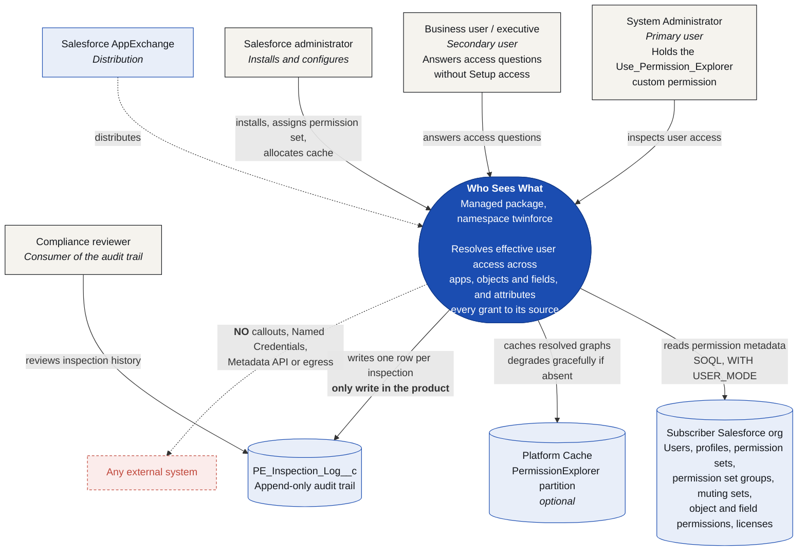

# 01 — C4 Level 1: System Context

Who interacts with Who Sees What, and what it depends on.

## Notes

- The **delegation USP** is visible here: the secondary user reaches the system without ever
  traversing Setup.
- The dashed red edge is a deliberate architectural statement, not an omission. See
  [ADR-0001](../adr/0001-read-only-no-callouts.md).
- The audit trail is drawn as an external consumer relationship because a compliance reviewer reads
  it through Salesforce reporting, not through the product UI (a viewer is planned).
