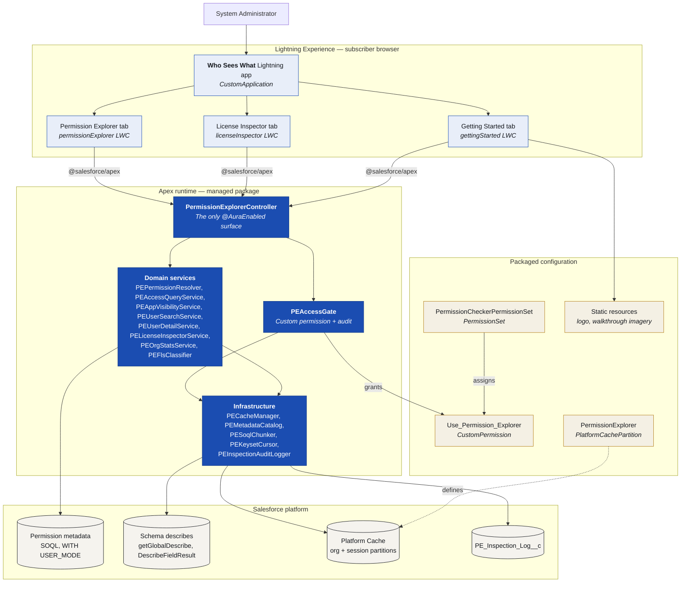

# 02 — C4 Level 2: Containers

The runtime pieces inside the package boundary.

## Notes

- Three tabs, three exposed LWCs. Every other component is a child and is never surfaced directly.
- All three tabs funnel through one controller — see
  [ADR-0006](../adr/0006-single-auraenabled-controller.md).
- Packaged configuration is drawn separately because it is what the subscriber administrator
  interacts with at install time, not at runtime.
