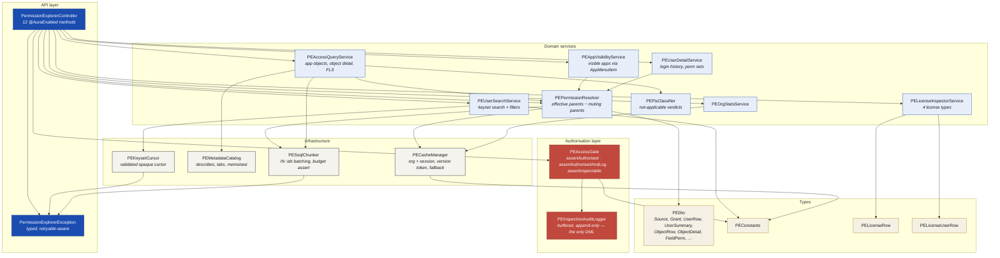

# 03 — C4 Level 3: Apex Components

Decomposition of the Apex layer, with dependency direction.

## Dependency rules

1. Dependencies point **downward only**. No infrastructure class knows about a service; no service
   knows about the controller.
2. `PEAccessGate` is the only authorisation authority.
3. `PEInspectionAuditLogger` is the only class performing DML.
4. `PEAccessQueryService`, `PEAppVisibilityService` and `PEUserDetailService` consume
   `PEPermissionResolver.Resolved` rather than re-deriving the permission graph.
