# 04 — LWC Component Tree

Composition of the Lightning Web Component layer. Only the three root components are exposed
(`isExposed: true`); everything else is a child.

```mermaid
flowchart TD
    subgraph EXPOSED["Exposed components — tab targets"]
        PEX["<b>permissionExplorer</b><br/>Permission Explorer tab"]
        LI["<b>licenseInspector</b><br/>License Inspector tab"]
        GS["<b>gettingStarted</b><br/>Getting Started tab"]
    end

    PEX --> USH["peUserSummaryHeader"]
    PEX --> OSB["peOrgStatsBar"]
    PEX --> UC["peUserColumn<br/><i>WHO</i>"]
    PEX --> AC["peAppColumn<br/><i>WHERE — apps</i>"]
    PEX --> OL["peObjectList<br/><i>WHERE — objects</i>"]
    PEX --> WC["peWhatColumn<br/><i>WHAT</i>"]
    PEX --> GBP["peGrantedByPanel"]
    PEX --> AT["peAccessTrace"]
    PEX --> MOD["peModal"]
    PEX --> LHM["peLoginHistoryModal"]
    PEX --> ULM["peUserListModal"]

    UC --> SI["peSearchInput"]
    UC --> LB["peListbox"]
    UC --> PG["pePaginator"]
    UC --> SW1["peStateWrapper"]

    LB --> CC["peCrudChips"]
    LB --> SC1["peSourceChip"]

    AC --> SW2["peStateWrapper"]
    OL --> SW3["peStateWrapper"]

    WC --> FT["peFieldTable"]
    WC --> NA["peNotAnalysed"]
    WC --> SW4["peStateWrapper"]
    FT --> SC2["peSourceChip"]

    LI --> SW5["peStateWrapper"]
    LHM --> SW6["peStateWrapper"]
    ULM --> SW7["peStateWrapper"]

    SW1 & SW2 & SW3 & SW4 & SW5 & SW6 & SW7 --> SK["peSkeleton"]

    subgraph SHARED["Shared, non-rendering"]
        BASE["peBase<br/><i>CSS-only bundle — no .js, no .html</i><br/>@import 'c/peBase';"]
        UTIL["peUtils<br/>accessLabels · constants · cursorStack<br/>errors · urlState"]
    end

    subgraph UNUSED["Not currently rendered"]
        CS["peCrudStrip<br/><i>superseded by peCrudChips</i>"]
        PGS["peGettingStarted<br/><i>superseded by gettingStarted</i>"]
    end

    classDef exposed fill:#1b4db1,stroke:#123a8a,color:#fff
    classDef comp fill:#e8eef9,stroke:#1b4db1,color:#15181D
    classDef shared fill:#f4f0e4,stroke:#B4801F,color:#15181D
    classDef dead fill:#fbeceb,stroke:#C0483C,color:#C0483C,stroke-dasharray:4 3
    class PEX,LI,GS exposed
    class USH,OSB,UC,AC,OL,WC,GBP,AT,MOD,LHM,ULM,SI,LB,PG,CC,SC1,SC2,FT,NA,SK,SW1,SW2,SW3,SW4,SW5,SW6,SW7 comp
    class BASE,UTIL shared
    class CS,PGS dead
```

## Notes

- **`peBase` is intentionally a CSS-only bundle.** It has no `.js` and no `.html` and is consumed
  through `@import 'c/peBase';` in ten sibling stylesheets. It is not broken — do not "fix" it.
- `peStateWrapper` is the shared loading/empty/error shell, wrapping `peSkeleton`. Every async region
  goes through it so loading behaviour is consistent.
- `peCrudStrip` and `peGettingStarted` are not referenced from any template or tab. See
  [CLEANUP-CANDIDATES.md](../CLEANUP-CANDIDATES.md).
- `peUtils` holds pure helpers — cheap, high-value unit test targets.
