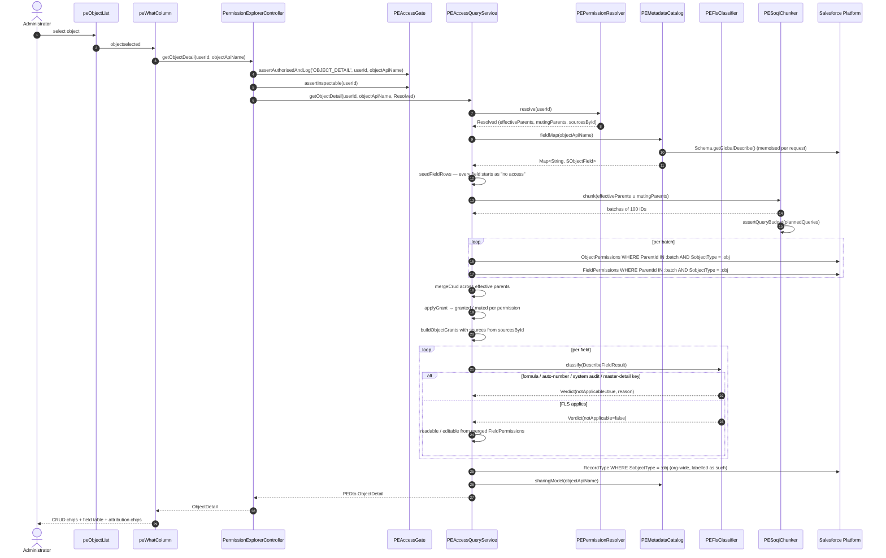

# 06 — Sequence: Build Object Detail and Field-Level Security

The WHAT column: from an object click to a classified field table with attribution.

## Notes

- **Fields are seeded from the describe, not from `FieldPermissions`.** A field with no row in
  `FieldPermissions` means *no access*, not *absent*. Seeding first is what prevents silently
  dropping inaccessible fields from the table.
- `PESoqlChunker` batches `ParentId IN :ids` at 100 and asserts the query budget before fan-out, so a
  user with many permission sets fails loudly rather than hitting a governor limit mid-render.
- Record types returned here are **org-wide**. See
  [ADR-0007](../adr/0007-defer-record-types-to-metadata-api.md).
