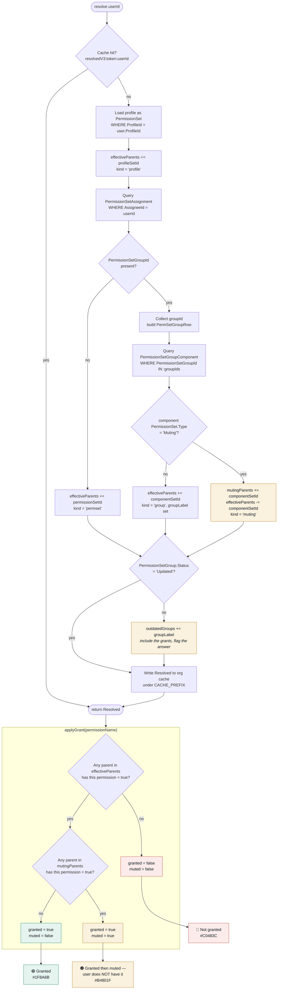

# 07 — Permission Resolution Flow

How grants and muting combine into an answer. This is the product's core logic; see
[PERMISSION-RESOLUTION.md](../PERMISSION-RESOLUTION.md) for the narrative.

## The rule that is easy to get wrong

Muting is **scoped to its own permission set group**. A muting set in group A does not cancel a
permission granted by a *direct* assignment or by the profile, nor one granted by group B. A resolver
that treats `mutingParents` as an org-wide subtraction set will under-report access — the opposite
error to the union bug, and just as wrong.

Scenarios 4, 5, 6 and 8 in [TESTING.md](../TESTING.md) §3 exist to pin this down.
