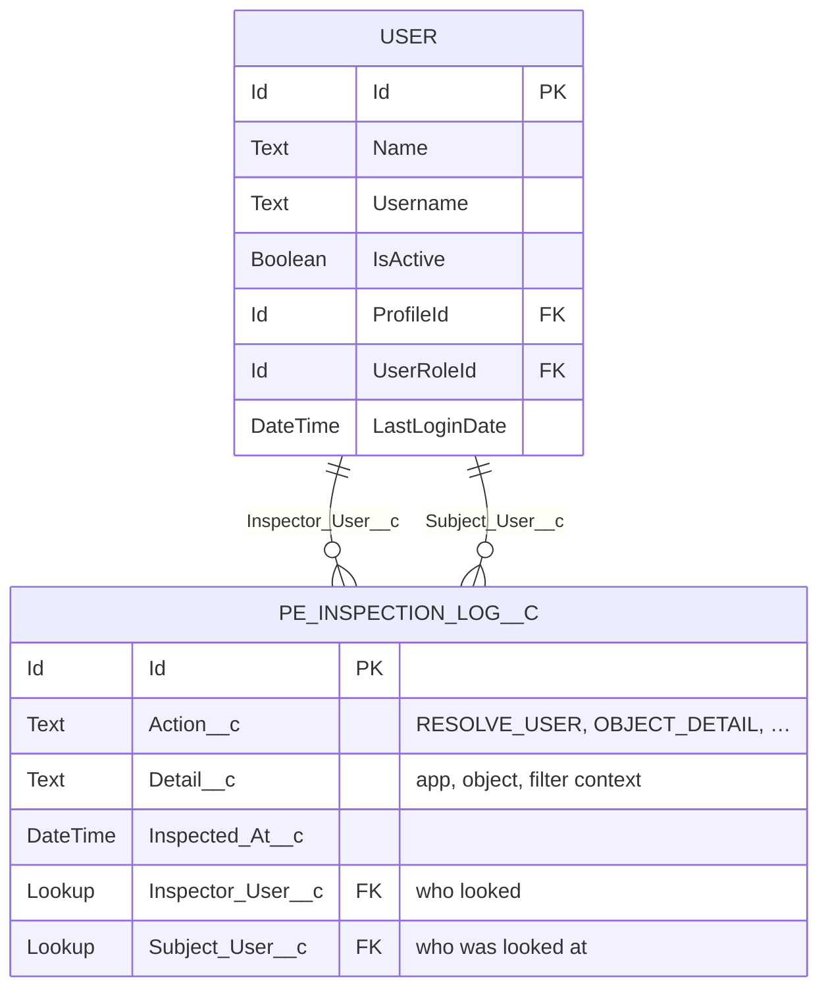
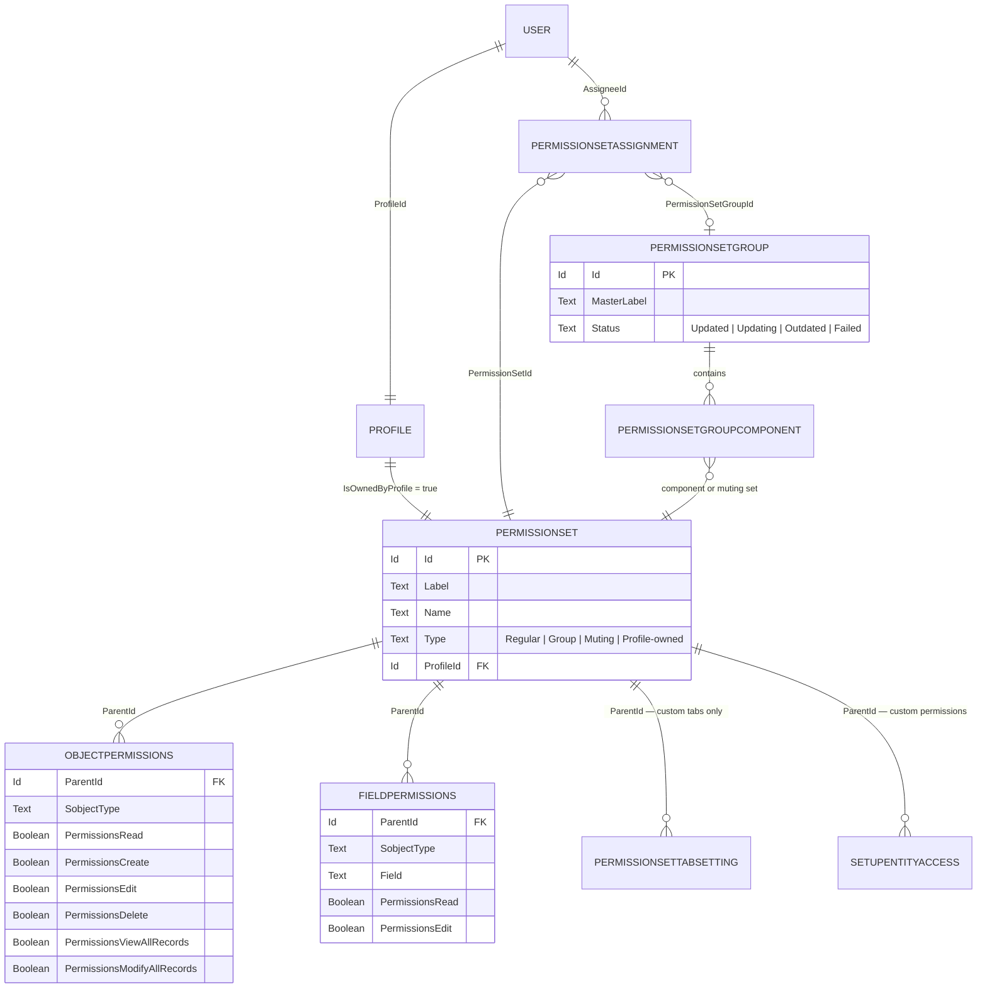
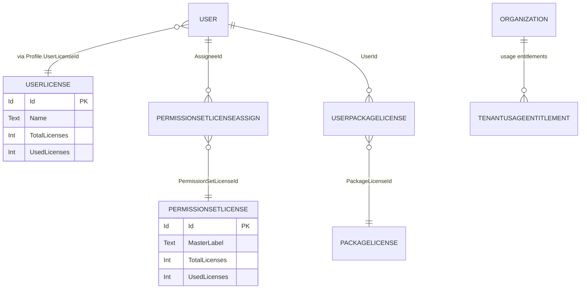

# 08 — Entity Relationship

The one object this package creates, and the platform objects it reads.

## Packaged object

Create and Read are granted. **Edit, Delete, View All and Modify All are withheld**, which is what
makes the trail worth keeping. See [ADR-0002](../adr/0002-custom-permission-gate-and-audit.md).

## Permission graph read from the platform

**`PermissionSet.Type = 'Muting'` is the single field the entire differentiator rests on.**
`PermissionSetGroup.Status` is the second — it determines whether the computed answer is also the
live answer.

## Licensing read from the platform

## Not represented

No queryable entity exists for per-user record type visibility, page layout assignment,
per-permission-set app visibility, or standard object tab visibility. These live only in Metadata API
representations. See [ADR-0007](../adr/0007-defer-record-types-to-metadata-api.md).
