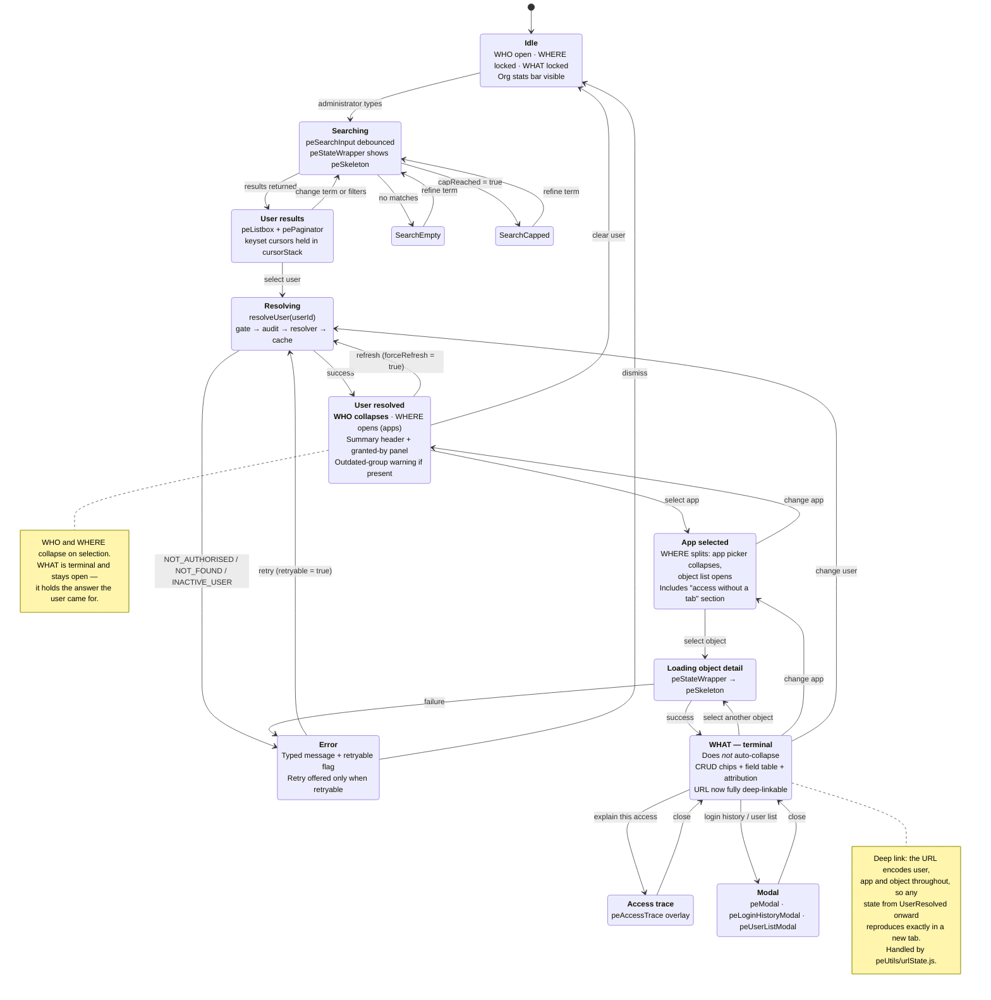

# 09 — UI State Machine: WHO / WHERE / WHAT

Staged navigation in `permissionExplorer`. The accordion behaviour is deliberate, not decorative:
collapsing a completed stage keeps the answer — not the navigation — on screen.

## Rules

- **Only WHO and WHERE collapse.** WHAT is the payload; collapsing it would hide the answer.
- Changing an upstream selection invalidates downstream state rather than leaving a stale field
  table attached to a different user.
- Every asynchronous region is wrapped in `peStateWrapper`, so loading, empty and error presentation
  is identical everywhere.
- Retry is offered only when the error carries `retryable = true`. Offering retry on
  `NOT_AUTHORISED` would waste the user's time.
