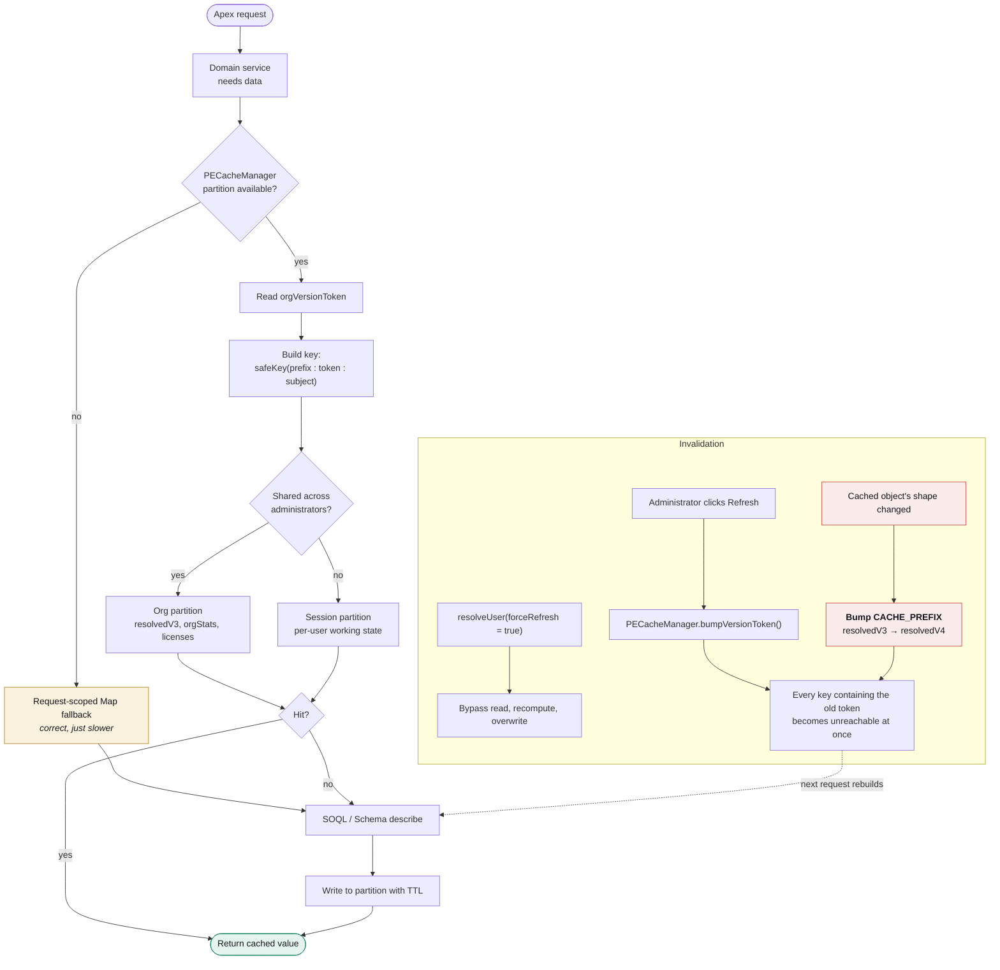

# 10 — Caching and Invalidation

Where data comes from, how long it lives, and how it is invalidated.

## Key inventory

| Key shape | Partition | Holds | Invalidated by |
| --- | --- | --- | --- |
| `orgVersionToken` | Org | The token itself | `bumpVersionToken()` |
| `resolvedV3:<token>:<userId>` | Org | `PEPermissionResolver.Resolved` | token bump · `forceRefresh` · TTL |
| `orgStats:<token>` | Org | `PEDto.OrgStats` | token bump · TTL |
| `licenses:<token>` | Org | Serialised license rows | token bump · TTL |

## Rules

1. **Cache is an optimisation, never a source of truth.** Fallback must always produce the same
   answer, only slower.
2. **The version token participates in every key.** One bump invalidates everything, which is why the
   refresh control can be a single button rather than a per-key purge.
3. **Bump `CACHE_PREFIX` whenever the shape of a cached object changes.** A payload of the old shape
   deserialises *without error* and silently loses fields — a resolved graph missing its
   `mutingParents` reads as "this user has no muting sets", which is exactly the wrong answer
   delivered confidently. This is the most dangerous known failure mode in the codebase.
4. **Sanitise every key.** Platform Cache keys are alphanumeric only; raw object API names and
   usernames will throw.
5. **Never resolve partition availability through a self-referencing static property getter.** Use an
   explicit `*Resolved` boolean — the recursion has bitten this codebase once already.
