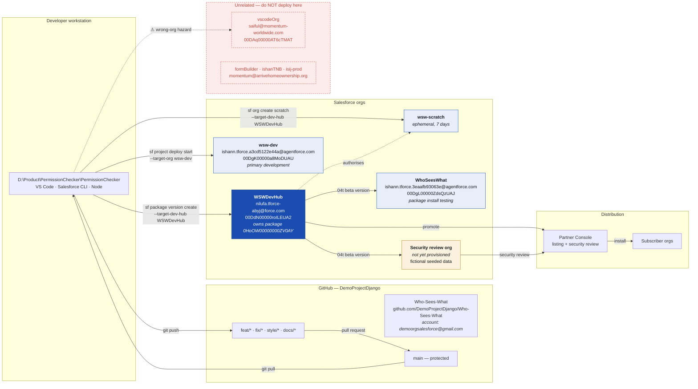

# 11 — Deployment Topology

Orgs, repository and what flows between them.



## The hazard

`vscodeOrg` resolves to `saiful@momentum-worldwide.com`, an org belonging to an entirely different
engagement. A stray `sf project deploy start` without an explicit target has landed there before.

```powershell
sf config set target-org=wsw-dev
sf config set target-dev-hub=WSWDevHub
sf config get target-org --verbose
```

Pass `--target-org wsw-dev` explicitly on every deploy regardless of configuration. Full inventory:
[SALESFORCE-ENVIRONMENTS.md](../SALESFORCE-ENVIRONMENTS.md).
