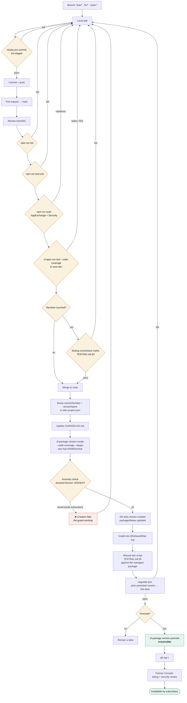

# 12 — Release Pipeline

From a local change to an installed package version.

## Gates that must not be skipped

| Gate | Why |
| --- | --- |
| `npm run scan` zero violations | The AppExchange security review runs the same rulesets |
| 75% Apex coverage | Salesforce refuses to create the version below it |
| Muting correctness matrix | The product's core claim; fails silently if wrong |
| Manual test against the **installed package** | Namespace prefixes, packaged custom permissions and cache partitions only behave correctly under a real install |
| Upgrade test from the prior promoted version | Subscribers upgrade; they do not install fresh |

## Irreversibility

Promotion cannot be undone. There is no un-promote. Recovery is forward-only: ship a patch version,
or deprecate the version so it can no longer be installed. That asymmetry is why every gate above
sits *before* the promote step. See [RELEASE-PROCESS.md](../RELEASE-PROCESS.md) §9.
