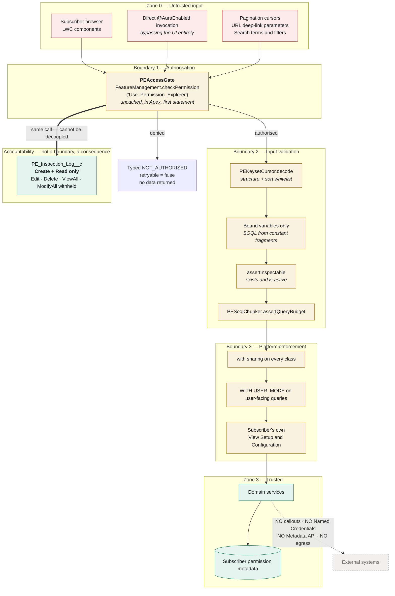

# 13 — Security Trust Boundaries

Where trust is established, and what each boundary defends against.

## What each boundary defends

| Boundary | Threat | Control |
| --- | --- | --- |
| 1 — Authorisation | Anyone invoking Apex directly, bypassing the UI | Gate in Apex, first statement of every method, never in the UI alone |
| 1 — Authorisation | A cached decision outliving its context (`System.runAs`) | `checkPermission` is deliberately uncached |
| 2 — Input validation | SOQL injection via search terms or sort fields | Bound variables; dynamic SOQL assembled from constant fragments; sort whitelist |
| 2 — Input validation | Tampered pagination cursor | `decode` validates and throws `BAD_CURSOR` |
| 2 — Input validation | Governor-limit exhaustion via a wide permission graph | `assertQueryBudget` before fan-out |
| 3 — Platform | CRUD/FLS bypass | `with sharing` everywhere, `WITH USER_MODE` |
| 3 — Platform | Reading permission metadata the admin cannot read | Subscriber's own View Setup and Configuration still applies |
| Accountability | Untraceable inspections | `assertAuthorisedAndLog` couples gate and audit in one call |
| Accountability | Inspector erasing their own trail | Edit and Delete withheld on the audit object |
| Egress | Data exfiltration | No callouts, no Named Credentials, no Metadata API, no external endpoints |

The heavy edge from the gate to the audit log is the important one: an inspection **cannot** occur
without producing a log row, because the same call does both. See
[ADR-0002](../adr/0002-custom-permission-gate-and-audit.md) and
[SECURITY-MODEL.md](../SECURITY-MODEL.md).
