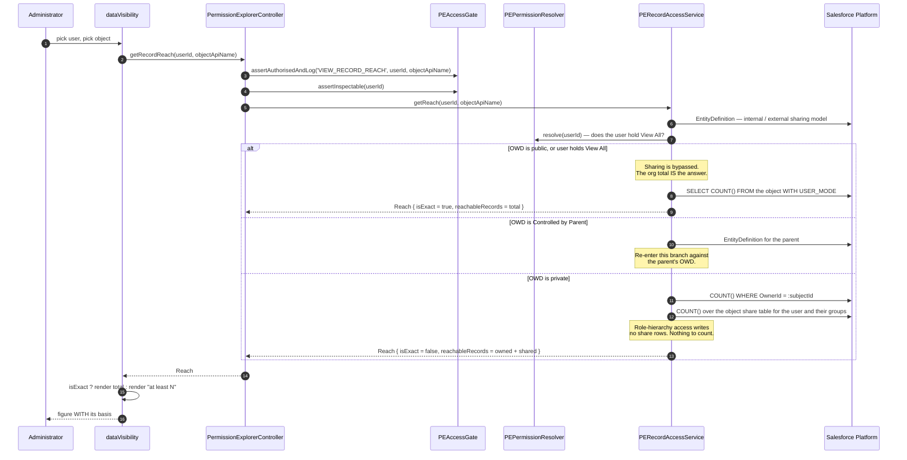

# 14 — Sequence: Record Reach

How Data Visibility decides a reach figure, and where the exact-versus-floor branch happens.

The branch is the point of the diagram. Everything else is plumbing.

## The two things this diagram exists to pin

**Step 6.** `totalRecords` is counted `WITH USER_MODE` as the **running** administrator. It is a
denominator. Rendering it as the subject's access is wrong, and it is wrong in the direction that
overstates.

**The final step.** `isExact` is not optional metadata. A client that renders `reachableRecords`
without consulting it turns a careful answer into a false one — and under a private org-wide default
the error **understates** access, which is how an access review passes something it should not.

## See also

- [../RECORD-VISIBILITY.md](../RECORD-VISIBILITY.md)
- [../adr/0009-record-reach-approximation.md](../adr/0009-record-reach-approximation.md)
- [../TESTING.md](../TESTING.md) §3b — the correctness matrix for this branch
