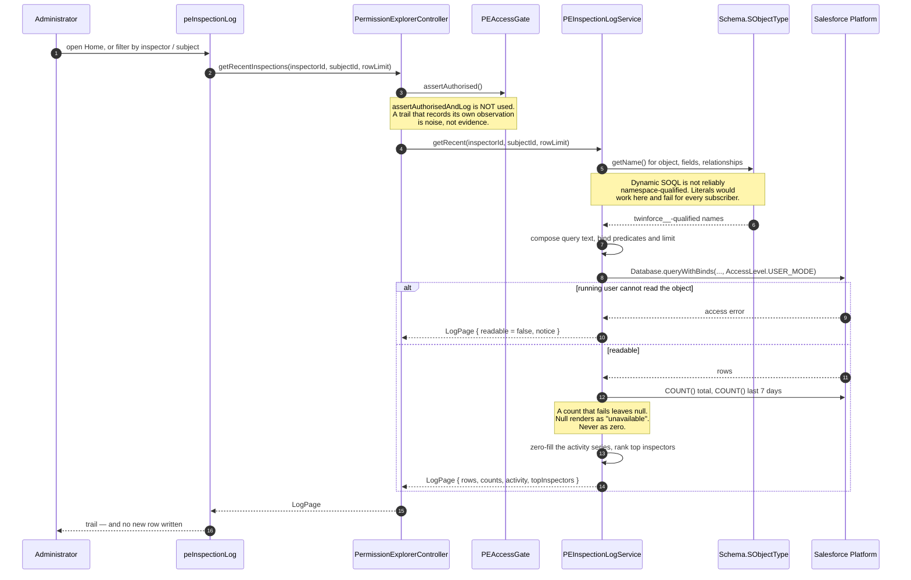

# 15 — Sequence: Inspection Log Read

How the audit trail is read back, and why this is the one gated path that writes nothing.

## Three design points

**No row is written.** This is the only gated method in the product that deliberately does not log.
The asymmetry is intentional and will otherwise read as an oversight — see
[../adr/0010-inspection-log-read-path.md](../adr/0010-inspection-log-read-path.md).

**Names come from describe.** The class originally used four literal static SOQL variants. They
compiled in the dev org and would have failed for every subscriber, where the object is
`twinforce__PE_Inspection_Log__c`. Fixed in `0.6.0-2`; recorded as
[../adr/0012-namespace-safe-dynamic-soql.md](../adr/0012-namespace-safe-dynamic-soql.md).

**There is no write path in the class at all.** No update, no delete — not disabled, not present.
Combined with the packaged permission set withholding Edit and Delete, an inspector can read history
without being able to rewrite it. That is the whole reason the object is worth keeping.

## See also

- [../AUDIT-TRAIL.md](../AUDIT-TRAIL.md)
- [13-security-trust-boundaries.md](13-security-trust-boundaries.md)
